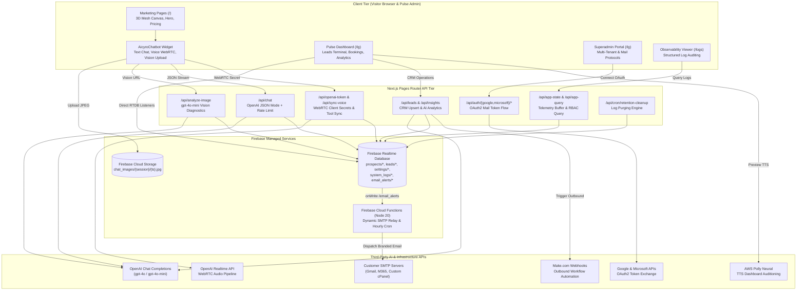

# System Architecture & Technical Specification
**Project:** CloseDesk (Branded as Aicyro)  
**Workspace:** `CloseDesk-Aicyro-GIT`  
**Runtime & Framework:** Next.js 16 (Pages Router), React 19, Tailwind CSS 3, Node.js 20+  
**Cloud & AI Backend:** Firebase Realtime Database & Storage, Firebase Cloud Functions (Node 20), OpenAI (Chat Completions JSON, Vision `gpt-4o-mini`, Realtime WebRTC), AWS Polly Neural TTS  
**Architectural Role:** Multimodal AI Front-Desk & Operations Platform for Home-Service Enterprises

---

## 1. Complete Architecture Tree

Below is the exhaustive directory and file layout of the repository. Every directory and file is annotated with its operational role:

```text
CloseDesk-Aicyro-GIT/
│
├── .github/
│   └── workflows/
│       └── retention-cron.yml              # [Active] Daily GitHub Actions cron calling log retention API
│
├── docs/                                   # Architectural specifications & compliance documents
│   ├── LOGGING_SCHEMA.md                   # [Active] Canonical JSON schema specification for structured logging
│   ├── VOICE_PRIVACY_POLICY.md             # [Active] Compliance & disclosure policy for WebRTC voice sessions
│   ├── VOICE_PRODUCTION_READINESS_SIGNOFF.md # [Active] Production certification & audit checklist
│   └── VOICE_QA_TEST_SUITE.md              # [Active] Test matrix for Realtime voice edge-cases & tools
│
├── evaluations/                            # Model evaluation reports & synthetic benchmarks
│   └── report_v2.1.0.json                  # [Active] Synthetic benchmark report from run_evaluations.js
│
├── functions/                              # Firebase Cloud Functions (v1, Node 20 runtime)
│   ├── .eslintrc.js                        # [Active] Linter configuration for Cloud Functions
│   ├── .gitignore                          # [Active] Function-level gitignore
│   ├── package.json                        # [Active] Function dependencies (firebase-admin, nodemailer, etc.)
│   ├── package-lock.json                   # [Active] Pinned function dependency tree
│   ├── index.js                            # [Active] Cloud Functions: dynamic SMTP mailer & reminder cron
│   └── assets/
│       └── logo.png                        # [REDUNDANT] Unused raster logo (index.js embeds inline SVG)
│
├── public/                                 # Public static assets served at domain root
│   ├── apple-touch-icon.png                # [Active] iOS home-screen icon referenced in Seo.jsx
│   ├── icon.png                            # [Active] Favicon referenced in Seo.jsx and dashboard
│   ├── robots.txt                          # [Active] Production search engine crawler rules
│   ├── avatars/                            # Chatbot avatar vector assets
│   │   ├── 1.svg                           # [REDUNDANT] 0-byte orphan file
│   │   ├── ai-spark.svg                    # [Active] Default AI Spark chatbot avatar
│   │   ├── bot-classic.svg                 # [Active] Classic robot chatbot avatar
│   │   ├── human-agent.svg                 # [Active] Human concierge avatar option
│   │   ├── image.png                       # [REDUNDANT] Unreferenced avatar image
│   │   └── minimal-dot.svg                 # [Active] Minimalist glowing dot avatar
│   ├── demo.mp4                            # [REDUNDANT] Unreferenced product demo video
│   ├── logowhite.png                       # [REDUNDANT] Unreferenced inverted logo
│   ├── OG-image.jpg                        # [REDUNDANT] Capitalized duplicate social share preview
│   ├── og-image.png                        # [REDUNDANT] Duplicate social share PNG
│   ├── og-image.svg                        # [REDUNDANT] Unused vector social banner
│   └── robot.svg                           # [REDUNDANT] Unreferenced robot illustration
│
├── scripts/                                # Diagnostic tools, CI runners, and QA simulators
│   ├── industry_regression_suite.js        # [Active] Automated API test runner across 4 home-service verticals
│   ├── qa-simulator.js                     # [Active] End-to-end chat and voice session simulator
│   ├── run_evaluations.js                  # [Active] Evaluation harness (npm run test:ai) testing safety & handoffs
│   ├── vad_tuning_harness.js               # [Active] Voice Activity Detection tuning runner for silence timeouts
│   └── voice_qa_harness.js                 # [Active] OpenAI TTS audio generator for pronunciation QA
│
├── src/                                    # Application source code
│   ├── database.json                       # [SECURITY HAZARD / REDUNDANT] Plaintext credentials seed file
│   │
│   ├── assets/                             # Bundled assets (Webpack-managed)
│   │   ├── Analytics.json                  # [REDUNDANT] 78 KB unreferenced Lottie animation file
│   │   ├── icon.png                        # [Active] Brand icon used in Seo.jsx and dashboard profile
│   │   ├── icon.svg                        # [REDUNDANT] Unreferenced icon SVG
│   │   ├── iconwhite.png                   # [REDUNDANT] Unreferenced white icon PNG
│   │   ├── logo.png                        # [REDUNDANT] Unreferenced logo PNG
│   │   ├── logowhite.png                   # [REDUNDANT] Unreferenced white logo PNG
│   │   └── robot.svg                       # [REDUNDANT] Unreferenced robot vector
│   │
│   ├── components/                         # UI Components
│   │   ├── GlobalActivityTracker.jsx       # [Active] Telemetry listener catching window errors & 404s
│   │   ├── ThemeProvider.jsx               # [Active] Dynamic theme context provider (public vs. dashboard)
│   │   ├── ThemeToggle.jsx                 # [REDUNDANT] Unused standalone theme switcher
│   │   │
│   │   ├── Chatbot/
│   │   │   └── AicyroChatbot.jsx           # [Active] Multimodal customer front desk (Chat, Voice, Vision)
│   │   │
│   │   ├── Dashboard/                      # Pulse Admin Dashboard (/lg) screens
│   │   │   ├── Booking.jsx                 # [Active] Appointments & booking calendar management
│   │   │   ├── Conversations.jsx           # [Active] Live chat & voice transcripts browser
│   │   │   ├── CookieDataDisplay.jsx       # [Active] Visitor cookie, telemetry, and geolocation view
│   │   │   ├── HomeScreen.jsx              # [Active] Executive KPI overview & pipeline velocity
│   │   │   ├── Insight.jsx                 # [Active] AI-generated lead intelligence with Recharts
│   │   │   ├── LiveNotifications.jsx       # [Active] Real-time administrative notification feed
│   │   │   ├── LoginScreen.jsx             # [Active] Tenant administrator authentication portal
│   │   │   ├── NewScreen.jsx               # [REDUNDANT] Unreferenced blank template stub
│   │   │   ├── OperatingHours.jsx          # [REDUNDANT] Unreferenced operating hours display
│   │   │   ├── Report.jsx                  # [Active] Performance analytics & CSV export reporting
│   │   │   ├── SettingsScreen.jsx          # [REDUNDANT] Abandoned 777-line monolithic settings component
│   │   │   ├── TerminalScreen.jsx          # [Active] Inbound lead triage & CRM sync terminal
│   │   │   │
│   │   │   ├── cookie/
│   │   │   │   ├── CookieGrid.jsx          # [Active] Detailed visitor telemetry data table
│   │   │   │   └── CookieMap.jsx           # [Active] Interactive Google Maps visitor cluster visualizer
│   │   │   │
│   │   │   ├── Settings/                   # Modularized Pulse Settings
│   │   │   │   ├── apearance.jsx           # [Active] Accent color hues & public theme preview
│   │   │   │   ├── BusinessProfile.jsx     # [Active] Operating hours, address, and profile settings
│   │   │   │   ├── Chatbotsetting.jsx      # [Active] AI persona, rules, qualification, and TTS preview
│   │   │   │   ├── notification-settings.jsx # [Active] Outbound SMTP configuration & admin alerts
│   │   │   │   └── PasswordChange.jsx      # [Active] Administrator password reset module
│   │   │   │
│   │   │   └── superadmin/                 # Master Platform Superadmin (/lg superadmin view)
│   │   │       ├── ClientManagement.jsx    # [Active] Multi-tenant client onboarding & credential CRUD
│   │   │       ├── SuperAdminDashboard.jsx # [Active] Superadmin portal shell & navigation
│   │   │       ├── superadminlogin.jsx     # [Active] Superadmin credentials authentication gate
│   │   │       └── Settings/
│   │   │           ├── SuperAdminAppearance.jsx    # [Active] Master theme appearance customizer
│   │   │           └── SuperAdminEmailProtocol.jsx # [Active] Multi-provider email protocol configurator
│   │   │
│   │   ├── Essential/                      # Shared platform layout & SEO
│   │   │   ├── CookieConsentBanner.jsx     # [Active] CCPA/GDPR cookie consent dialog
│   │   │   ├── Footer.jsx                  # [Active] Public marketing footer
│   │   │   ├── Navbar.jsx                  # [Active] Primary responsive marketing navbar
│   │   │   ├── Navbar copy.jsx             # [REDUNDANT] Near-duplicate navbar used only by audit page
│   │   │   ├── Secondary_navbar.jsx        # [REDUNDANT] 0-byte orphan file
│   │   │   └── Seo.jsx                     # [Active] Metadata, OpenGraph, and JSON-LD schema tags
│   │   │
│   │   ├── Form/                           # Lead generation popups
│   │   │   ├── Popupform.jsx               # [Active] Multi-step lead qualification modal dialog
│   │   │   └── PopupModel.jsx              # [REDUNDANT] Commented-out 431-line dead duplicate popup
│   │   │
│   │   ├── Home/                           # Active marketing homepage sections
│   │   │   ├── Compare.jsx                 # [Active] Feature matrix comparing CloseDesk vs. traditional tools
│   │   │   ├── Cta.jsx                     # [Active] Primary bottom conversion banner
│   │   │   ├── Faq.jsx                     # [Active] Expandable accordion FAQ
│   │   │   ├── Hero.jsx                    # [Active] Above-the-fold value proposition & CTA triggers
│   │   │   ├── NightScene.jsx              # [Active] After-hours revenue capture visualization
│   │   │   ├── NotFor.jsx                  # [Active] Customer qualification / anti-persona section
│   │   │   ├── Offer.jsx                   # [Active] Core deliverables and pricing guarantee breakdown
│   │   │   ├── Pricing.jsx                 # [Active] Interactive tier comparison card
│   │   │   ├── Problem.jsx                 # [Active] Revenue leakage & missed call problem breakdown
│   │   │   ├── TheTurn.jsx                 # [Active] Behavioral shift from answering service to closer
│   │   │   └── Trust.jsx                   # [Active] Social proof, security badges, and uptime metrics
│   │   │
│   │   └── Home/OLD/                       # [REDUNDANT] Deprecated legacy homepage components (commented out in index.jsx)
│   │       ├── DoneForYou.jsx              # [REDUNDANT]
│   │       ├── FaqAndFooter.jsx            # [REDUNDANT]
│   │       ├── Founding.jsx                # [REDUNDANT]
│   │       ├── Industries.jsx              # [REDUNDANT]
│   │       ├── LivePreviewSection.jsx      # [REDUNDANT]
│   │       ├── Process.jsx                 # [REDUNDANT]
│   │       ├── Pulse.jsx                   # [REDUNDANT]
│   │       ├── Solution.jsx                # [REDUNDANT]
│   │       ├── Speed.jsx                   # [REDUNDANT]
│   │       └── TheDifference.jsx           # [REDUNDANT]
│   │
│   ├── lib/                                # Core utilities, clients, and telemetry framework
│   │   ├── activityTracker.js              # [Active] In-browser analytics transmitter
│   │   ├── aiTracer.js                     # [Active] AI completion tracer & safe JSON parser
│   │   ├── alertManager.js                 # [Active] Throttled critical alerting engine writing to RTDB
│   │   ├── apiMiddleware.js                # [Active] withApiLogger HOC with correlation & latency tracking
│   │   ├── auditTracer.js                  # [Active] SOC2-style administrative audit logger
│   │   ├── cookiePersonalization.js        # [Active] Cookie consent reader & anonymous UUID generator
│   │   ├── dbTracer.js                     # [Active] Firebase Realtime Database operation profiler
│   │   ├── firebase.js                     # [Active] Client Firebase singleton initializing RTDB & Storage
│   │   ├── integrationTracer.js            # [Active] Outbound HTTP integration client with retry & sanitization
│   │   ├── logger.js                       # [Active] Structured logging engine with PII redaction
│   │   ├── loggerPresets.js                # [Active] Contextual logger factories (Website, API, AI, Voice, Pulse)
│   │   ├── notificationHelper.js           # [Active] Notification creator & email_alerts queue dispatcher
│   │   ├── ragTracer.js                    # [Active] Vector knowledge retrieval tracer
│   │   ├── retryTracer.js                  # [Active] Resilient exponential backoff retry executor
│   │   ├── ruleBook.js                     # [Active] AI System prompt & policy book (v2.11.0)
│   │   ├── toolTracer.js                   # [REDUNDANT] Unreferenced tool call execution tracer
│   │   ├── tracer.js                       # [Active] Distributed tracing utility (UUIDs & fetchWithTrace)
│   │   └── visionRuleBook.js               # [Active] AI Vision defect prompt & domain rules (v1.1.0)
│   │
│   ├── pages/                              # Next.js Pages Router
│   │   ├── _app.jsx                        # [Active] Global App shell, providers, and route transition logging
│   │   ├── _document.jsx                   # [Active] HTML Document with anti-FOUC theme hydration script
│   │   ├── layout.jsx                      # [Active] Chatbot widget mount wrapper (skips /lg and /logs)
│   │   ├── index.jsx                       # [Active] High-performance landing page with 3D canvas mesh
│   │   ├── lg.jsx                          # [Active] Pulse Admin & Superadmin Dashboard application
│   │   ├── logs.jsx                        # [Active] Dedicated observability log explorer UI
│   │   ├── free-website-audit.jsx          # [Active] 16-step website audit wizard with PDF generation
│   │   ├── 404.jsx                         # [Active] Branded custom 404 error page
│   │   ├── privacy.jsx                     # [Active] Privacy policy legal disclosure
│   │   ├── cookie.jsx                      # [Active] Cookie policy legal disclosure
│   │   ├── termofuse.jsx                   # [Active] Terms of service legal disclosure
│   │   │
│   │   └── api/                            # Backend API Routes
│   │       ├── analytics.js                # [Active] Visitor interaction & geo-analytics ingestion
│   │       ├── analyze-image.js            # [Active] Multimodal vision defect classifier (gpt-4o-mini)
│   │       ├── app-query.js                # [Active] RBAC-protected structured log query endpoint
│   │       ├── app-state.js                # [Active] Structured log transmission ingestion receiver
│   │       ├── chat.js                     # [Active] Conversational AI chat endpoint (OpenAI JSON mode)
│   │       ├── generate-audit.js           # [Active] Website audit analysis generator (GPT-4o)
│   │       ├── generate-email.js           # [Active] Make.com webhook dispatcher for outbound email campaigns
│   │       ├── insights.js                 # [Active] Lead KPI & conversational trend summarizer
│   │       ├── leads.js                    # [Active] Lead upsert, deduplication, and abandoned chat summarizer
│   │       ├── login.js                    # [Active] Tenant administrator password authentication endpoint
│   │       ├── openai-token.js             # [Active] Ephemeral WebRTC token minter for OpenAI Realtime Voice
│   │       ├── openai-token copy.js        # [REDUNDANT] Dead commented-out copy of token endpoint
│   │       ├── openai-token copy 2.js      # [REDUNDANT] Outdated unsecured copy of token endpoint
│   │       ├── sync-voice.js               # [Active] Realtime voice telemetry, transcripts & tool executor
│   │       ├── tts.js                      # [Active] AWS Polly neural text-to-speech preview endpoint
│   │       ├── upload-logo.js              # [DANGEROUS / REDUNDANT] Misnamed duplicate of openai-token.js
│   │       │
│   │       ├── auth/                       # OAuth2 Provider Handlers
│   │       │   ├── google/
│   │       │   │   ├── login.js            # [Active] Google OAuth2 consent redirection
│   │       │   │   └── callback.js         # [Active] Google token exchange & RTDB configuration writer
│   │       │   └── microsoft/
│   │       │       ├── login.js            # [Active] Microsoft 365 OAuth2 consent redirection
│   │       │       └── callback.js         # [Active] Microsoft token exchange & RTDB configuration writer
│   │       │
│   │       └── cron/
│   │           └── retention-cleanup.js    # [Active] Automated log retention cleanup (CRON_SECRET protected)
│   │
│   └── styles/                             # Cascading Style Sheets
│       ├── globals.css                     # [Active] Global Tailwind directives & CSS theme variables
│       └── globals copy.css                # [REDUNDANT] Legacy duplicate stylesheet
│
├── .env.local                              # [Active] Local environment variables (gitignored)
├── .eslintrc.json                          # [REDUNDANT] Legacy ESLint config (conflicts with eslint.config.mjs)
├── .firebaserc                             # [Active] Firebase project binding (aichatbot-a6217)
├── .gitignore                              # [Active] Git exclusion rules
├── .npmrc                                  # [Active] NPM package resolution configuration
├── eslint.config.mjs                       # [Active] Modern Flat ESLint configuration (Next.js core-web-vitals)
├── firebase.json                           # [Active] Firebase Cloud Functions deployment target config
├── jsconfig.json                           # [Active] TypeScript/JavaScript path alias mapper (@/* -> ./src/*)
├── next.config.js                          # [Active] Next.js engine runtime settings
├── og-image.jpg                            # [REDUNDANT] Root-level social preview image (unserved by Next.js)
├── package.json                            # [Active] Application dependencies, scripts, and engine specs
├── package-lock.json                       # [Active] Application dependency lockfile
├── postcss.config.js                       # [Active] PostCSS Tailwind & Autoprefixer plugin pipeline
├── README.md                               # [Active] Basic project overview & setup guide
├── REDIRECT_CONFIG.md                      # [REDUNDANT] Stale documentation for unconfigured redirects
├── REPOSITORY_ANALYSIS.md                  # [Active] Historical baseline architecture analysis
└── tailwind.config.js                      # [Active] Tailwind theme design tokens, fonts, and dark mode rules
```

---

### High-Level System Architecture Diagram



---

## 2. File-Level Functionality & Dependencies (Active Files)

### 2.1 Configuration & Root Infrastructure

#### [package.json](file:///d:/Software%20House%2001/CloseDesk-Aicyro-GIT/package.json)
- **Core Logic & Specific Functionalities:** Defines root dependencies, npm scripts (`dev`, `build`, `start`, `lint`, `test:ai`), project metadata (`aicyronext`), and Node runtime specifications.
- **Role in Architecture:** Primary package manifest managing the Next.js runtime, UI libraries, Firebase client SDK, AWS Polly SDK, and OpenAI client libraries.
- **Internal Dependencies:** References `scripts/run_evaluations.js` in `test:ai`.
- **External Dependencies:** `next`, `react`, `react-dom`, `firebase`, `openai`, `@aws-sdk/client-polly`, `@vis.gl/react-google-maps`, `jspdf`, `lucide-react`, `recharts`, `tailwindcss`, `postcss`, `autoprefixer`, `eslint`.

#### [next.config.js](file:///d:/Software%20House%2001/CloseDesk-Aicyro-GIT/next.config.js)
- **Core Logic & Specific Functionalities:** Configures Next.js compiler options, strictly enforcing `reactStrictMode: true`.
- **Role in Architecture:** Global Next.js configuration gateway controlling asset prefixing, build behavior, and environment optimization.
- **Internal Dependencies:** None.
- **External Dependencies:** `next`.

#### [jsconfig.json](file:///d:/Software%20House%2001/CloseDesk-Aicyro-GIT/jsconfig.json)
- **Core Logic & Specific Functionalities:** Configures TypeScript/JavaScript path resolution aliases, mapping `@/*` to `./src/*`.
- **Role in Architecture:** Ensures clean, maintainable module imports across all pages, components, and libraries.
- **Internal Dependencies:** Maps `./src/*`.
- **External Dependencies:** None.

#### [tailwind.config.js](file:///d:/Software%20House%2001/CloseDesk-Aicyro-GIT/tailwind.config.js)
- **Core Logic & Specific Functionalities:** Defines utility-first styling rules, class-based dark mode (`darkMode: "class"`), custom CSS color variable mappings (`var(--primary)`, `var(--background)`), and content scan paths across `src/pages` and `src/components`.
- **Role in Architecture:** Central design system controller powering the platform's adaptive dark/light/accent theme engine.
- **Internal Dependencies:** Scans `src/pages/**/*.{js,ts,jsx,tsx}`, `src/components/**/*.{js,ts,jsx,tsx}`.
- **External Dependencies:** `tailwindcss`.

#### [postcss.config.js](file:///d:/Software%20House%2001/CloseDesk-Aicyro-GIT/postcss.config.js)
- **Core Logic & Specific Functionalities:** Configures PostCSS transformations, attaching Tailwind CSS and Autoprefixer to the asset build pipeline.
- **Role in Architecture:** CSS post-processing pipeline ensuring cross-browser prefix compatibility.
- **Internal Dependencies:** None.
- **External Dependencies:** `postcss`, `tailwindcss`, `autoprefixer`.

#### [eslint.config.mjs](file:///d:/Software%20House%2001/CloseDesk-Aicyro-GIT/eslint.config.mjs)
- **Core Logic & Specific Functionalities:** Flat ESLint configuration modernizing Next.js 16 linting; binds `next/core-web-vitals`.
- **Role in Architecture:** Code quality enforcer guaranteeing compliance with React 19 and Next.js Core Web Vitals standards.
- **Internal Dependencies:** None.
- **External Dependencies:** `@eslint/eslintrc`, `eslint-config-next`.

#### [firebase.json](file:///d:/Software%20House%2001/CloseDesk-Aicyro-GIT/firebase.json)
- **Core Logic & Specific Functionalities:** Instructs the Firebase CLI to deploy serverless Cloud Functions located in the `functions/` subdirectory.
- **Role in Architecture:** Cloud Functions deployment and environment configuration file.
- **Internal Dependencies:** Binds `functions/`.
- **External Dependencies:** Firebase CLI.

#### [.firebaserc](file:///d:/Software%20House%2001/CloseDesk-Aicyro-GIT/.firebaserc)
- **Core Logic & Specific Functionalities:** Binds the local workspace to the active Firebase Cloud project (`aichatbot-a6217`).
- **Role in Architecture:** Project routing for Firebase CLI deployments.
- **Internal Dependencies:** None.
- **External Dependencies:** Firebase CLI.

#### [.gitignore](file:///d:/Software%20House%2001/CloseDesk-Aicyro-GIT/.gitignore)
- **Core Logic & Specific Functionalities:** Defines source control ignore rules, excluding `node_modules`, `.next`, `.env*`, `.netlify`, npm debug logs, and build artifacts.
- **Role in Architecture:** Repository cleanliness and secrets isolation guardian.
- **Internal Dependencies:** None.
- **External Dependencies:** Git.

#### [.npmrc](file:///d:/Software%20House%2001/CloseDesk-Aicyro-GIT/.npmrc)
- **Core Logic & Specific Functionalities:** Configures npm behavior with `legacy-peer-deps=true`.
- **Role in Architecture:** Prevents peer dependency conflicts between React 19, Next.js 16, and third-party UI libraries during package resolution.
- **Internal Dependencies:** None.
- **External Dependencies:** npm.

#### [.github/workflows/retention-cron.yml](file:///d:/Software%20House%2001/CloseDesk-Aicyro-GIT/.github/workflows/retention-cron.yml)
- **Core Logic & Specific Functionalities:** Scheduled GitHub Action triggered daily at `00:00 UTC` and manually via `workflow_dispatch`. Executes an HTTP POST with `Authorization: Bearer ${{ secrets.CRON_SECRET }}` against the production endpoint `https://aicyro.pro/api/cron/retention-cleanup`.
- **Role in Architecture:** Infrastructure maintenance scheduler automating compliance log purging in accordance with database retention policies.
- **Internal Dependencies:** Triggers `src/pages/api/cron/retention-cleanup.js`.
- **External Dependencies:** GitHub Actions runtime, `curl`.

---

### 2.2 Serverless Cloud Functions (`functions/`)

#### [functions/index.js](file:///d:/Software%20House%2001/CloseDesk-Aicyro-GIT/functions/index.js)
- **Core Logic & Specific Functionalities:**
  1. `getDynamicTransporter()`: Asynchronously reads SMTP and OAuth2 configurations from RTDB `settings/email_config`. Dynamically sets up Nodemailer transports for Microsoft OAuth2 (using `smtp-mail.outlook.com` on port 587 with Microsoft's v2 token endpoint), Google OAuth2 (using Gmail service), Custom SMTP (with host/port/SSL), or legacy basic auth fallbacks (`GMAIL_EMAIL`/`GMAIL_PASSWORD`).
  2. `sendEmailAlert`: Realtime Database `onCreate` trigger listening on `/email_alerts/{alertId}`. Validates `status === "pending"`, checks administrative routing gates in `users/root/notifications` (`emailAlerts`, `urgentOnly`, `afterHoursAlerts`, `adminEmail`, `leadReceivers`), compiles a responsive HTML notification with inline SVG branding (`COMPANY_LOGO_SVG`), dispatches outbound mail, updates alert status to `delivered`, and enqueues customer follow-up tasks in `scheduled_reminders`.
  3. `processScheduledReminders`: Hourly Pub/Sub cron function (`functions.pubsub.schedule("every 1 hours")`). Iterates over pending reminder documents whose scheduled time has elapsed, constructs dynamic transporters, dispatches automated re-engagement emails, and updates reminder records to `completed`.
- **Role in Architecture:** Backend asynchronous processing engine handling all automated email notifications and scheduled customer re-engagement without tying up the Next.js frontend server.
- **Internal Dependencies:** Reads RTDB nodes `settings/email_config`, `users/root/notifications`, `email_alerts`, and `scheduled_reminders`.
- **External Dependencies:** `firebase-functions/v1`, `firebase-admin`, `nodemailer`.

#### [functions/package.json](file:///d:/Software%20House%2001/CloseDesk-Aicyro-GIT/functions/package.json)
- **Core Logic & Specific Functionalities:** Defines Cloud Functions metadata, Node.js 20 engine requirement, and runtime dependencies.
- **Role in Architecture:** Package manifest for the Firebase Cloud Functions runtime.
- **Internal Dependencies:** None.
- **External Dependencies:** `firebase-admin` (^12.0.0), `firebase-functions` (^4.5.0), `nodemailer` (^6.9.9).

#### [functions/.eslintrc.js](file:///d:/Software%20House%2001/CloseDesk-Aicyro-GIT/functions/.eslintrc.js)
- **Core Logic & Specific Functionalities:** Configures ESLint with Google rules and ES2021 syntax for Cloud Functions code.
- **Role in Architecture:** Linter for backend function code.
- **Internal Dependencies:** None.
- **External Dependencies:** `eslint`, `eslint-config-google`.

#### [functions/.gitignore](file:///d:/Software%20House%2001/CloseDesk-Aicyro-GIT/functions/.gitignore)
- **Core Logic & Specific Functionalities:** Excludes `node_modules` and local runtime environment files from Cloud Function deployments.
- **Role in Architecture:** Deployment hygiene for serverless functions.
- **Internal Dependencies:** None.
- **External Dependencies:** Git.

---

### 2.3 Diagnostic Tools & Automation Harnesses (`scripts/`)

#### [scripts/run_evaluations.js](file:///d:/Software%20House%2001/CloseDesk-Aicyro-GIT/scripts/run_evaluations.js)
- **Core Logic & Specific Functionalities:** Programmatic benchmark suite executed via `npm run test:ai`. Simulates high-intent customer dialogues across pricing objections, customer support escalation, and data deletion requests. Sends payloads to local `/api/chat`, validates output schemas, verifies security constraints (PII redaction, prompt injection defense), and exports comprehensive evaluation reports to `evaluations/report_v{version}.json`.
- **Role in Architecture:** Model policy evaluation harness guaranteeing zero regression in AI front-desk behavior before production deployments.
- **Internal Dependencies:** Targets `src/pages/api/chat.js`; writes `evaluations/report_*.json`.
- **External Dependencies:** Node.js native `fetch`, `fs`, `path`.

#### [scripts/industry_regression_suite.js](file:///d:/Software%20House%2001/CloseDesk-Aicyro-GIT/scripts/industry_regression_suite.js)
- **Core Logic & Specific Functionalities:** Automated regression harness simulating edge-case dialogues across 4 specialized service verticals (HVAC gas leaks, Plumbing burst pipes, Restoration fires, Roofing storm emergencies). Tests safety triggers, forbidden behaviors (e.g., diagnosing gas leaks instead of advising evacuation), simulated 500 booking API failures, and structured JSON output conformance.
- **Role in Architecture:** Vertical-specific compliance and safety test runner validating rulebook policy execution.
- **Internal Dependencies:** Targets `src/pages/api/chat.js`.
- **External Dependencies:** Node.js native `fetch`.

#### [scripts/qa-simulator.js](file:///d:/Software%20House%2001/CloseDesk-Aicyro-GIT/scripts/qa-simulator.js)
- **Core Logic & Specific Functionalities:** Smoke test simulator that creates synthetic sessions, generates correlation IDs, fires requests against `/api/chat` and `/api/sync-voice`, and asserts telemetry persistence in Firebase Realtime Database.
- **Role in Architecture:** Integration smoke tester for local development and CI pipelines.
- **Internal Dependencies:** Interacts with `/api/chat` and `/api/sync-voice`.
- **External Dependencies:** Node.js native `fetch`.

#### [scripts/vad_tuning_harness.js](file:///d:/Software%20House%2001/CloseDesk-Aicyro-GIT/scripts/vad_tuning_harness.js)
- **Core Logic & Specific Functionalities:** Tests voice activity detection (VAD) parameters (`silence_duration_ms`, `prefix_padding_ms`, `threshold`) against synthetic silence and audio frame chunks to optimize speech cutoff latency without clipping customer responses.
- **Role in Architecture:** Parameter optimization tool for OpenAI Realtime Voice WebRTC configuration.
- **Internal Dependencies:** Validates configurations used in `src/pages/api/openai-token.js`.
- **External Dependencies:** Node.js native libraries.

#### [scripts/voice_qa_harness.js](file:///d:/Software%20House%2001/CloseDesk-Aicyro-GIT/scripts/voice_qa_harness.js)
- **Core Logic & Specific Functionalities:** Synthesizes sample MP3 audio files using OpenAI's TTS API for specific trade terminology (e.g., "R-410A refrigerant", "hydro-jetting", "PEX piping") to evaluate pronunciation clarity and cadence across available voice personas.
- **Role in Architecture:** Acoustic quality assurance tool for voice front-desk configuration.
- **Internal Dependencies:** None.
- **External Dependencies:** `openai`, `fs`, `path`.

---

### 2.4 Core Library & Tracing Framework (`src/lib/`)

#### [src/lib/firebase.js](file:///d:/Software%20House%2001/CloseDesk-Aicyro-GIT/src/lib/firebase.js)
- **Core Logic & Specific Functionalities:** Singleton client SDK initialization module. Checks `getApps().length` to prevent re-initialization during hot reloading, initializes Firebase using `NEXT_PUBLIC_FIREBASE_*` environment variables, and exports `db` (`getDatabase(app)`) and `storage` (`getStorage(app)`).
- **Role in Architecture:** Foundation data gateway providing client and API-route access to Realtime Database and Cloud Storage.
- **Internal Dependencies:** Exported to all API routes, dashboard screens, and chatbot modules.
- **External Dependencies:** `firebase/app`, `firebase/database`, `firebase/storage`.

#### [src/lib/ruleBook.js](file:///d:/Software%20House%2001/CloseDesk-Aicyro-GIT/src/lib/ruleBook.js)
- **Core Logic & Specific Functionalities:**
  1. Houses master system prompts and behavioral policies (`POLICY_VERSION = "2.11.0"`).
  2. Implements `getMasterRuleBook(mode)`: Dynamically queries `settings/chatbot_config` from Firebase RTDB (caching with a 60-second TTL), falling back to robust hardcoded corporate defaults (`DEFAULT_BOT_CONFIG`).
  3. Compiles mode-specific instructions: `text` mode enforces strict JSON schema generation (`reply`, `qualification_step`, `context_patch`, `is_urgent`, `lead_details`); `voice` mode enforces strict conversational brevity, short turn latency, phone-number phonetic spelling, and tool calling conventions (`submit_lead`, `check_availability`, `escalate_to_human`).
- **Role in Architecture:** Single source of truth for conversational AI intelligence, security boundaries, and lead qualification logic.
- **Internal Dependencies:** Imports `db` from `./firebase`.
- **External Dependencies:** `firebase/database`.

#### [src/lib/visionRuleBook.js](file:///d:/Software%20House%2001/CloseDesk-Aicyro-GIT/src/lib/visionRuleBook.js)
- **Core Logic & Specific Functionalities:**
  1. Houses the OpenAI Vision system prompt (`VISION_POLICY_VERSION = "1.1.0"`).
  2. Restricts defect analysis strictly to allowed home-service trades (HVAC, Plumbing, Electrical, Roofing, Mold/Water Damage, Structural).
  3. Enforces domain safety: If an uploaded image is irrelevant (e.g., pets, landscapes, selfies, memes), the model sets `is_irrelevant: true`, generates a friendly redirect message, and rejects defect logging. If relevant, extracts `identified_issue`, `affected_component`, `urgency_rating` (Low/Medium/High/Emergency), and actionable recommendations.
- **Role in Architecture:** Policy and schema gatekeeper for multimodal visual defect triage.
- **Internal Dependencies:** Imported by `src/pages/api/analyze-image.js`.
- **External Dependencies:** None.

#### [src/lib/cookiePersonalization.js](file:///d:/Software%20House%2001/CloseDesk-Aicyro-GIT/src/lib/cookiePersonalization.js)
- **Core Logic & Specific Functionalities:** Client-side cookie management utility. Reads and writes `closedesk_consent` and `closedesk_anon_id`. Generates cryptographic UUIDs for anonymous visitor tracking, enforces expiration policies (180 days for consent, 30 days for identity), and provides consent checking methods (`hasConsent()`).
- **Role in Architecture:** Regulatory compliance (GDPR/CCPA) and visitor session identification controller.
- **Internal Dependencies:** Imported by `CookieConsentBanner.jsx`, `tracer.js`, `loggerPresets.js`, `activityTracker.js`.
- **External Dependencies:** Browser `document.cookie`, `crypto.randomUUID()`.

#### [src/lib/logger.js](file:///d:/Software%20House%2001/CloseDesk-Aicyro-GIT/src/lib/logger.js)
- **Core Logic & Specific Functionalities:** Central structured logging engine implementing the canonical JSON schema defined in `docs/LOGGING_SCHEMA.md`. Sanitizes metadata by recursively redacting PII and credentials (passwords, tokens, credit cards, emails, phone numbers). Employs an internal memory queue, flushing log records via non-blocking HTTP POST to `/api/app-state`. Integrates with `alertManager` to trigger alerts on `CRITICAL` events.
- **Role in Architecture:** Observability backbone capturing performance metrics, API transactions, AI reasoning traces, and platform errors.
- **Internal Dependencies:** Imports `./alertManager`.
- **External Dependencies:** Browser/Node native `fetch`.

#### [src/lib/loggerPresets.js](file:///d:/Software%20House%2001/CloseDesk-Aicyro-GIT/src/lib/loggerPresets.js)
- **Core Logic & Specific Functionalities:** Factory creating domain-specific pre-configured loggers: `createWebsiteLogger`, `createApiLogger`, `createAiLogger`, `createVoiceLogger`, and `createPulseLogger`. Automatically injects component names, session IDs from cookies, and runtime environment tags.
- **Role in Architecture:** Developer interface standardizing log formats across public pages, APIs, AI subsystems, and admin screens.
- **Internal Dependencies:** Imports `./logger`, `./cookiePersonalization`.
- **External Dependencies:** None.

#### [src/lib/alertManager.js](file:///d:/Software%20House%2001/CloseDesk-Aicyro-GIT/src/lib/alertManager.js)
- **Core Logic & Specific Functionalities:** Automated alerting subsystem. Intercepts high-severity events (`level === "CRITICAL"` or `500 Internal Server Errors`), applies an in-memory 5-minute throttling window per error signature to prevent notification storms, and records incident documents in RTDB `/system_alerts`.
- **Role in Architecture:** Incident escalation and alerting engine protecting operational reliability.
- **Internal Dependencies:** Imports `db` from `./firebase`.
- **External Dependencies:** `firebase/database`.

#### [src/lib/apiMiddleware.js](file:///d:/Software%20House%2001/CloseDesk-Aicyro-GIT/src/lib/apiMiddleware.js)
- **Core Logic & Specific Functionalities:** Higher-order function `withApiLogger(handler, componentName)`. Extracts or generates correlation IDs from incoming `x-correlation-id` headers, tracks execution duration with high-resolution timers (`performance.now()`), captures HTTP method, endpoint, and status codes, and automatically logs unhandled exceptions before returning standardized JSON error responses.
- **Role in Architecture:** Universal API wrapper ensuring complete observability and distributed tracing across all Next.js API endpoints.
- **Internal Dependencies:** Imports `createApiLogger` from `./loggerPresets`, `generateCorrelationId` from `./tracer`.
- **External Dependencies:** None.

#### [src/lib/tracer.js](file:///d:/Software%20House%2001/CloseDesk-Aicyro-GIT/src/lib/tracer.js)
- **Core Logic & Specific Functionalities:** Distributed tracing helper. Implements `generateCorrelationId()` (UUIDv4) and `fetchWithTrace(url, options)` which injects `x-correlation-id`, `traceparent`, and client session tokens into outgoing HTTP requests while attaching a 15-second `AbortController` timeout to prevent hanging connections.
- **Role in Architecture:** End-to-end request tracing and client-side network resiliency manager.
- **Internal Dependencies:** Imports `./cookiePersonalization`, `./loggerPresets`.
- **External Dependencies:** Browser/Node native `fetch`, `AbortController`.

#### [src/lib/aiTracer.js](file:///d:/Software%20House%2001/CloseDesk-Aicyro-GIT/src/lib/aiTracer.js)
- **Core Logic & Specific Functionalities:** Traces AI lifecycle events (`ai_inference_started`, `ai_inference_completed`, `ai_inference_failed`). Records model identifier, prompt version, input/output token counts, and latency. Provides `safeParseAiResponse(rawContent)` with markdown fence stripping and JSON syntax repair.
- **Role in Architecture:** LLM telemetry, cost tracking, and response parsing utility.
- **Internal Dependencies:** None.
- **External Dependencies:** None.

#### [src/lib/ragTracer.js](file:///d:/Software%20House%2001/CloseDesk-Aicyro-GIT/src/lib/ragTracer.js)
- **Core Logic & Specific Functionalities:** Traces knowledge retrieval operations (`rag_retrieval_started`, `rag_retrieval_completed`). Logs query hashes, retrieved document IDs, relevance similarity scores, and execution durations without recording private knowledge base text.
- **Role in Architecture:** Retrieval-Augmented Generation (RAG) performance and accuracy monitor.
- **Internal Dependencies:** None.
- **External Dependencies:** None.

#### [src/lib/dbTracer.js](file:///d:/Software%20House%2001/CloseDesk-Aicyro-GIT/src/lib/dbTracer.js)
- **Core Logic & Specific Functionalities:** Performance profiler for Firebase database transactions. Measures read/write latency, classifies error types (permission denied, network disconnect, timeout), and logs structured DB telemetry events.
- **Role in Architecture:** Database performance monitor and failure diagnostic tool.
- **Internal Dependencies:** None.
- **External Dependencies:** None.

#### [src/lib/retryTracer.js](file:///d:/Software%20House%2001/CloseDesk-Aicyro-GIT/src/lib/retryTracer.js)
- **Core Logic & Specific Functionalities:** Exponential backoff retry utility `executeWithRetry(fn, options)`. Retries idempotent operations upon encountering network failures or rate limits, applying randomized jitter and logging retry attempts.
- **Role in Architecture:** Network resilience and transient failure mitigation utility.
- **Internal Dependencies:** None.
- **External Dependencies:** None.

#### [src/lib/integrationTracer.js](file:///d:/Software%20House%2001/CloseDesk-Aicyro-GIT/src/lib/integrationTracer.js)
- **Core Logic & Specific Functionalities:** Outbound integration HTTP wrapper `fetchWithIntegrationTrace(serviceName, url, options)`. Sanitizes authorization headers, logs outbound requests and responses, measures external service latency, and executes retries via `retryTracer`.
- **Role in Architecture:** Third-party integration gateway protecting against external API failures (Make.com, webhooks).
- **Internal Dependencies:** Imports `./retryTracer`.
- **External Dependencies:** Browser/Node native `fetch`.

#### [src/lib/auditTracer.js](file:///d:/Software%20House%2001/CloseDesk-Aicyro-GIT/src/lib/auditTracer.js)
- **Core Logic & Specific Functionalities:** SOC2/compliance audit trail recorder `recordAuditTrail(actor, action, targetEntity, previousState, newState)`. Writes immutable audit event records to Firebase RTDB `/audit_trails`.
- **Role in Architecture:** Administrative security compliance and change-tracking engine.
- **Internal Dependencies:** Imports `db` from `./firebase`.
- **External Dependencies:** `firebase/database`.

#### [src/lib/activityTracker.js](file:///d:/Software%20House%2001/CloseDesk-Aicyro-GIT/src/lib/activityTracker.js)
- **Core Logic & Specific Functionalities:** Visitor interaction tracking utility. Binds page views (`trackVisit`), button clicks, and chatbot engagement events. Ignores administrative routes (`/lg`, `/logs`) to keep analytics pure, transmitting events to `/api/analytics`.
- **Role in Architecture:** Client-side telemetry emitter feeding marketing analytics.
- **Internal Dependencies:** Imports `./cookiePersonalization`.
- **External Dependencies:** Browser native `fetch`.

#### [src/lib/notificationHelper.js](file:///d:/Software%20House%2001/CloseDesk-Aicyro-GIT/src/lib/notificationHelper.js)
- **Core Logic & Specific Functionalities:** High-level dispatcher for alerts. Implements `logToFirebase(notificationData)` to write dashboard notifications to `/notifications` and `queueEmailAlert(alertPayload)` to write email requests to `/email_alerts` with `status: "pending"`, triggering the background Cloud Function.
- **Role in Architecture:** Bridge connecting user-facing interactions to administrative alert feeds and serverless email delivery.
- **Internal Dependencies:** Imports `db` from `./firebase`.
- **External Dependencies:** `firebase/database`.

---

### 2.5 API Routes (`src/pages/api/`)

#### [src/pages/api/chat.js](file:///d:/Software%20House%2001/CloseDesk-Aicyro-GIT/src/pages/api/chat.js)
- **Core Logic & Specific Functionalities:** Handles conversational text interactions. Rate-limits requests (15 requests/min per session). Scans input for prompt-injection attacks and jailbreaks. Loads current prospect state from RTDB `/prospects/{session_id}`. Retrieves system prompt via `getMasterRuleBook("text")`. Calls OpenAI Chat Completions in JSON mode (`response_format: { type: "json_object" }`). Parses output, merges qualification patches into the prospect graph, and checks for `TRIGGER_DATA_DELETION` flags to sanitize visitor records. Wraps execution with `aiTracer`, `ragTracer`, and `retryTracer`.
- **Role in Architecture:** Primary conversational AI controller for customer qualification, objection handling, and lead capture.
- **Internal Dependencies:** Imports `./lib/ruleBook`, `./lib/firebase`, `./lib/apiMiddleware`, `./lib/aiTracer`, `./lib/ragTracer`, `./lib/retryTracer`.
- **External Dependencies:** `openai`, `firebase/database`.

#### [src/pages/api/analyze-image.js](file:///d:/Software%20House%2001/CloseDesk-Aicyro-GIT/src/pages/api/analyze-image.js)
- **Core Logic & Specific Functionalities:** Multimodal vision diagnostic handler. Accepts `{ session_id, image_url, user_prompt }`. Fetches prospect trade context from RTDB. Invokes OpenAI Vision (`gpt-4o-mini`, `detail: "low"`). If irrelevant, returns an empathetic redirect message without writing defect records. If relevant, persists the diagnostic output in `/prospects/{session_id}/last_vision_inspection` and automatically patches or creates a lead in `/leads/{session_id}` with urgency and component data.
- **Role in Architecture:** Visual defect diagnostic engine for home-service damage appraisal.
- **Internal Dependencies:** Imports `./lib/visionRuleBook`, `./lib/firebase`, `./lib/apiMiddleware`.
- **External Dependencies:** `openai`, `firebase/database`.

#### [src/pages/api/openai-token.js](file:///d:/Software%20House%2001/CloseDesk-Aicyro-GIT/src/pages/api/openai-token.js)
- **Core Logic & Specific Functionalities:** Generates ephemeral client secrets for OpenAI Realtime API (WebRTC voice sessions). Validates session ID formatting (`lead_{timestamp}_{hash}`). Enforces a rate limit of 5 requests/min per IP/session. Checks `settings/chatbot_config.voiceEnabled`; returns HTTP 403 Forbidden if voice is disabled. Fetches voice instructions from `getMasterRuleBook("voice")`. Calls `https://api.openai.com/v1/realtime/client_secrets`, attaching tools (`submit_lead`, `check_availability`, `escalate_to_human`, `trigger_data_deletion`) and acoustic parameters (VAD threshold 0.5, silence duration 210ms, voice `ash`).
- **Role in Architecture:** Secure credential minter and voice policy compiler for direct browser-to-OpenAI WebRTC sessions.
- **Internal Dependencies:** Imports `./lib/ruleBook`, `./lib/firebase`, `./lib/apiMiddleware`.
- **External Dependencies:** Node native `fetch`, `firebase/database`.

#### [src/pages/api/sync-voice.js](file:///d:/Software%20House%2001/CloseDesk-Aicyro-GIT/src/pages/api/sync-voice.js)
- **Core Logic & Specific Functionalities:** Real-time WebRTC synchronization and tool execution handler. Accepts tool invocations, audio telemetry, transcripts, and error logs emitted by the client WebRTC session. Implements idempotency checks via RTDB `/session_actions/{session_id}`. Executes tools (saving customer contact details, checking appointment availability, triggering human escalation) and synchronizes results back to the prospect graph.
- **Role in Architecture:** Server-side execution backend for OpenAI Realtime voice tool calling and call telemetry.
- **Internal Dependencies:** Imports `./lib/firebase`, `./lib/apiMiddleware`.
- **External Dependencies:** `firebase/database`.

#### [src/pages/api/leads.js](file:///d:/Software%20House%2001/CloseDesk-Aicyro-GIT/src/pages/api/leads.js)
- **Core Logic & Specific Functionalities:** Manages lead lifecycle. `GET`: Retrieves all leads from RTDB `/leads` sorted by timestamp. `POST`: Upserts lead records. Implements deduplication based on email and phone numbers. If a session is marked abandoned (`is_abandoned: true`), calls OpenAI to generate an executive conversational summary highlighting customer intent, missing qualification details, and recommended follow-up actions.
- **Role in Architecture:** Central CRM gateway for lead ingestion, deduplication, and AI summarization.
- **Internal Dependencies:** Imports `./lib/firebase`, `./lib/apiMiddleware`, `./lib/dbTracer`.
- **External Dependencies:** `openai`, `firebase/database`.

#### [src/pages/api/insights.js](file:///d:/Software%20House%2001/CloseDesk-Aicyro-GIT/src/pages/api/insights.js)
- **Core Logic & Specific Functionalities:** Analytics summarizer. Fetches the last 50 leads from RTDB `/leads`. Sends structured lead data to OpenAI Chat Completions (`response_format: { type: "json_object" }`). Computes total pipeline value, estimated revenue, conversion rates, urgency breakdowns, top service requests, and sentiment scores. Returns chart-ready JSON consumed by the Pulse Insight dashboard.
- **Role in Architecture:** Intelligence generator transforming raw CRM data into executive dashboards.
- **Internal Dependencies:** Imports `./lib/firebase`, `./lib/apiMiddleware`.
- **External Dependencies:** `openai`, `firebase/database`.

#### [src/pages/api/generate-audit.js](file:///d:/Software%20House%2001/CloseDesk-Aicyro-GIT/src/pages/api/generate-audit.js)
- **Core Logic & Specific Functionalities:** Automated website auditor. Receives 16 questionnaire data points from `free-website-audit.jsx`. Calls OpenAI (`gpt-4o`) to generate an in-depth audit report assessing UX, SEO, speed, mobile responsiveness, and revenue conversion potential. Saves the completed audit in RTDB `/audits/{audit_id}` and returns formatted report metrics.
- **Role in Architecture:** Lead magnet engine driving user acquisition through automated audit reports.
- **Internal Dependencies:** Imports `./lib/firebase`, `./lib/apiMiddleware`.
- **External Dependencies:** `openai`, `firebase/database`.

#### [src/pages/api/generate-email.js](file:///d:/Software%20House%2001/CloseDesk-Aicyro-GIT/src/pages/api/generate-email.js)
- **Core Logic & Specific Functionalities:** Dispatches outbound webhook payloads to Make.com via `fetchWithIntegrationTrace`. Validates incoming payloads and triggers automated multichannel email and SMS campaigns.
- **Role in Architecture:** External marketing automation webhook bridge.
- **Internal Dependencies:** Imports `./lib/integrationTracer`, `./lib/apiMiddleware`.
- **External Dependencies:** None.

#### [src/pages/api/analytics.js](file:///d:/Software%20House%2001/CloseDesk-Aicyro-GIT/src/pages/api/analytics.js)
- **Core Logic & Specific Functionalities:** Visitor telemetry ingestion endpoint. Receives page view events, scroll depth, referrer information, and IP-derived geolocation coordinates. Aggregates daily counters and writes visitor session records to RTDB `/analytics/visitors` and `/analytics/events`.
- **Role in Architecture:** First-party visitor tracking and web traffic ingestion engine.
- **Internal Dependencies:** Imports `./lib/firebase`, `./lib/apiMiddleware`.
- **External Dependencies:** `firebase/database`.

#### [src/pages/api/app-state.js](file:///d:/Software%20House%2001/CloseDesk-Aicyro-GIT/src/pages/api/app-state.js)
- **Core Logic & Specific Functionalities:** Ingestion receiver for structured logs transmitted by `logger.js`. Directly writes log objects to RTDB `/system_logs/structured_events/{log_id}` using `firebase/database set()`. Intentionally does not wrap itself in `withApiLogger` to prevent infinite logging recursion loops.
- **Role in Architecture:** Direct ingestion pipeline for central observability logs.
- **Internal Dependencies:** Imports `./lib/firebase`.
- **External Dependencies:** `firebase/database`.

#### [src/pages/api/app-query.js](file:///d:/Software%20House%2001/CloseDesk-Aicyro-GIT/src/pages/api/app-query.js)
- **Core Logic & Specific Functionalities:** Query engine for the Observability Viewer (`/logs`). Enforces role-based query permissions. Fetches events from `/system_logs/structured_events/`, applying in-memory filtering by log level, component name, correlation ID, and timestamp range with a hard safety cap of 1,500 records.
- **Role in Architecture:** Secure search and audit query backend for system logs.
- **Internal Dependencies:** Imports `./lib/firebase`, `./lib/apiMiddleware`.
- **External Dependencies:** `firebase/database`.

#### [src/pages/api/login.js](file:///d:/Software%20House%2001/CloseDesk-Aicyro-GIT/src/pages/api/login.js)
- **Core Logic & Specific Functionalities:** Authenticates tenant administrator credentials against RTDB `/login`. Validates matching username and password, logs login success or failure to the audit trail via `recordAuditTrail`, and returns authentication tokens.
- **Role in Architecture:** Tenant authentication controller for the Pulse admin dashboard.
- **Internal Dependencies:** Imports `./lib/firebase`, `./lib/apiMiddleware`, `./lib/auditTracer`.
- **External Dependencies:** `firebase/database`.

#### [src/pages/api/tts.js](file:///d:/Software%20House%2001/CloseDesk-Aicyro-GIT/src/pages/api/tts.js)
- **Core Logic & Specific Functionalities:** Text-to-speech audio synthesizer using AWS Polly. Implements voice mapping: maps OpenAI voice `ash` to Polly neural voice `Matthew` to prevent synthesis errors. Synthesizes input text to `audio/mpeg` MP3 and streams the audio buffer directly to the client response.
- **Role in Architecture:** Audio auditioning endpoint allowing administrators to preview chatbot voices in `Chatbotsetting.jsx`.
- **Internal Dependencies:** Imports `./lib/apiMiddleware`.
- **External Dependencies:** `@aws-sdk/client-polly`.

#### [src/pages/api/cron/retention-cleanup.js](file:///d:/Software%20House%2001/CloseDesk-Aicyro-GIT/src/pages/api/cron/retention-cleanup.js)
- **Core Logic & Specific Functionalities:** Maintenance endpoint executed by GitHub Actions. Validates `Authorization: Bearer <CRON_SECRET>`. Queries retention configuration from RTDB `settings/log_retention` (defaulting to 30 days). Iterates through `/system_logs/structured_events/` and deletes records exceeding the retention threshold.
- **Role in Architecture:** Database maintenance task maintaining database performance and controlling storage costs.
- **Internal Dependencies:** Imports `./lib/firebase`, `./lib/apiMiddleware`.
- **External Dependencies:** `firebase/database`.

#### [src/pages/api/auth/google/login.js](file:///d:/Software%20House%2001/CloseDesk-Aicyro-GIT/src/pages/api/auth/google/login.js)
- **Core Logic & Specific Functionalities:** Initiates Google OAuth2 authorization flow. Constructs the Google consent URL with `access_type=offline`, `prompt=consent`, and Gmail send scopes (`https://www.googleapis.com/auth/gmail.send`), redirecting the administrator to grant mail permissions.
- **Role in Architecture:** Outbound email authorization starter for Google accounts.
- **Internal Dependencies:** None.
- **External Dependencies:** None.

#### [src/pages/api/auth/google/callback.js](file:///d:/Software%20House%2001/CloseDesk-Aicyro-GIT/src/pages/api/auth/google/callback.js)
- **Core Logic & Specific Functionalities:** Handles the Google OAuth2 redirect. Exchanges the authorization code for access and refresh tokens. Fetches the authenticated user's email address from Google UserInfo. Persists `refreshToken`, `clientId`, `clientSecret`, `provider: "google_oauth"`, and `smtpEmail` into RTDB `settings/email_config`. Redirects back to `/lg?status=google_auth_success`.
- **Role in Architecture:** OAuth credential store for Google-backed dynamic email delivery.
- **Internal Dependencies:** Imports `db` from `./lib/firebase`.
- **External Dependencies:** Node native `fetch`, `firebase/database`.

#### [src/pages/api/auth/microsoft/login.js](file:///d:/Software%20House%2001/CloseDesk-Aicyro-GIT/src/pages/api/auth/microsoft/login.js)
- **Core Logic & Specific Functionalities:** Initiates Microsoft 365 OAuth2 flow. Redirects the administrator to Microsoft's common OAuth endpoint with scopes `offline_access`, `https://outlook.office.com/SMTP.Send`, and `User.Read`.
- **Role in Architecture:** Outbound email authorization starter for Microsoft 365 / Outlook accounts.
- **Internal Dependencies:** None.
- **External Dependencies:** None.

#### [src/pages/api/auth/microsoft/callback.js](file:///d:/Software%20House%2001/CloseDesk-Aicyro-GIT/src/pages/api/auth/microsoft/callback.js)
- **Core Logic & Specific Functionalities:** Microsoft OAuth2 callback handler. Exchanges authorization code with Microsoft Graph token endpoint. Queries Microsoft Graph API (`https://graph.microsoft.com/v1.0/me`) for user email. Stores `refreshToken`, `provider: "microsoft"`, and mail credentials in RTDB `settings/email_config`. Redirects back to `/lg?status=microsoft_auth_success`.
- **Role in Architecture:** OAuth credential store for Microsoft-backed dynamic email delivery.
- **Internal Dependencies:** Imports `db` from `./lib/firebase`.
- **External Dependencies:** Node native `fetch`, `firebase/database`.

---

### 2.6 Routing & Application Shell (`src/pages/`)

#### [src/pages/_app.jsx](file:///d:/Software%20House%2001/CloseDesk-Aicyro-GIT/src/pages/_app.jsx)
- **Core Logic & Specific Functionalities:** Root application wrapper. Initializes `ThemeProvider`, `RootLayout`, and `GlobalActivityTracker`. Hooks into Next.js router events (`routeChangeComplete`), generating unique correlation IDs and dispatching navigation telemetry via `trackVisit`. Renders `CookieConsentBanner` across all pages except `/logs`.
- **Role in Architecture:** Client application shell coordinating global state, theming, telemetry, and layout wrapping.
- **Internal Dependencies:** Imports `layout.jsx`, `ThemeProvider.jsx`, `GlobalActivityTracker.jsx`, `CookieConsentBanner.jsx`, `activityTracker.js`, `tracer.js`, `loggerPresets.js`, `globals.css`.
- **External Dependencies:** `next/router`, `react`.

#### [src/pages/_document.jsx](file:///d:/Software%20House%2001/CloseDesk-Aicyro-GIT/src/pages/_document.jsx)
- **Core Logic & Specific Functionalities:** Custom HTML document skeleton. Injects an anti-FOUC (Flash of Unstyled Content) inline script that inspects `localStorage.getItem("theme")` and applies dark/light classes to `document.documentElement` before React hydration begins (skipping `/lg` to preserve dashboard theme overrides).
- **Role in Architecture:** Initial server-rendered HTML template ensuring zero theme flickering.
- **Internal Dependencies:** None.
- **External Dependencies:** `next/document`.

#### [src/pages/layout.jsx](file:///d:/Software%20House%2001/CloseDesk-Aicyro-GIT/src/pages/layout.jsx)
- **Core Logic & Specific Functionalities:** Global layout wrapper. Inspects current `router.pathname`. Mounts `AicyroChatbot` on public marketing pages while suppressing it on operational surfaces (`/lg` and `/logs`).
- **Role in Architecture:** Conditional widget mounting controller isolating admin interfaces from public chat.
- **Internal Dependencies:** Imports `AicyroChatbot.jsx`.
- **External Dependencies:** `next/router`, `react`.

#### [src/pages/index.jsx](file:///d:/Software%20House%2001/CloseDesk-Aicyro-GIT/src/pages/index.jsx)
- **Core Logic & Specific Functionalities:** Main public landing page. Renders an interactive 3D particle mesh on an HTML5 canvas element with custom cursor glow. Coordinates marketing sections (`Hero`, `NightScene`, `TheTurn`, `Problem`, `Pricing`, `Compare`, `NotFor`, `Trust`, `Offer`, `Faq`, `CTA`, `Footer`). Manages modal visibility for `Popupform`.
- **Role in Architecture:** Primary conversion and marketing front-door for CloseDesk/Aicyro.
- **Internal Dependencies:** Imports `Seo.jsx`, `Navbar.jsx`, `Footer.jsx`, `Popupform.jsx`, and all active `Home/*` section components.
- **External Dependencies:** `react`.

#### [src/pages/lg.jsx](file:///d:/Software%20House%2001/CloseDesk-Aicyro-GIT/src/pages/lg.jsx)
- **Core Logic & Specific Functionalities:** Pulse Operations & Superadmin Dashboard. Manages authentication state (persisted in session storage, terminating on tab reload for security). Supports switching between tenant admin and superadmin modes. Establishes live Firebase RTDB listeners for leads, bookings, notifications, and settings. Provides sub-view navigation: Overview (`HomeScreen`), Inbound Leads (`TerminalScreen`), Bookings (`Booking`), AI Intelligence (`Insight`), Transcripts (`Conversations`), Reporting (`Report`), Visitor Geolocation (`CookieDataDisplay`), and Settings (`Settings/*`).
- **Role in Architecture:** Central administrative operating system for business owners, operators, and platform superadmins.
- **Internal Dependencies:** Imports `db` from `./lib/firebase`, `loggerPresets.js`, and all `Dashboard/*` screen and setting components.
- **External Dependencies:** `firebase/database`, `react`.

#### [src/pages/logs.jsx](file:///d:/Software%20House%2001/CloseDesk-Aicyro-GIT/src/pages/logs.jsx)
- **Core Logic & Specific Functionalities:** Observability viewer. Authenticates operators via administrative access keys. Polls `/api/app-query` to display real-time structured logs with search, severity filtering (DEBUG, INFO, WARN, ERROR, CRITICAL), correlation ID tracing, and expandable JSON metadata inspectors.
- **Role in Architecture:** Ops monitoring and troubleshooting console for system diagnostics.
- **Internal Dependencies:** Queries `/api/app-query`.
- **External Dependencies:** `lucide-react`, `react`.

#### [src/pages/free-website-audit.jsx](file:///d:/Software%20House%2001/CloseDesk-Aicyro-GIT/src/pages/free-website-audit.jsx)
- **Core Logic & Specific Functionalities:** Interactive 16-step website audit wizard. Collects performance and business metrics, posts data to `/api/generate-audit`, renders audit scores and breakdown cards, and exports client-side PDF reports using `jsPDF`.
- **Role in Architecture:** Inbound lead qualification and marketing audit tool.
- **Internal Dependencies:** Imports `Navbar copy.jsx`, `Footer.jsx`, `Seo.jsx`.
- **External Dependencies:** `jspdf`, `lucide-react`, `react`.

#### [src/pages/404.jsx](file:///d:/Software%20House%2001/CloseDesk-Aicyro-GIT/src/pages/404.jsx)
- **Core Logic & Specific Functionalities:** Custom 404 error page. Themed with glowing SVG animations, branded typography, and navigation recovery actions redirecting lost visitors to the homepage or audit wizard.
- **Role in Architecture:** User experience recovery and error routing page.
- **Internal Dependencies:** Imports `Navbar.jsx`, `Footer.jsx`, `Seo.jsx`.
- **External Dependencies:** `next/link`, `react`.

#### [src/pages/privacy.jsx](file:///d:/Software%20House%2001/CloseDesk-Aicyro-GIT/src/pages/privacy.jsx)
- **Core Logic & Specific Functionalities:** Comprehensive privacy disclosure outlining data processing, OpenAI model interactions, voice session handling, cookie tracking, and CCPA/GDPR consumer rights.
- **Role in Architecture:** Legal compliance page for user data protection.
- **Internal Dependencies:** Imports `Navbar.jsx`, `Footer.jsx`, `Seo.jsx`.
- **External Dependencies:** `react`.

#### [src/pages/cookie.jsx](file:///d:/Software%20House%2001/CloseDesk-Aicyro-GIT/src/pages/cookie.jsx)
- **Core Logic & Specific Functionalities:** Cookie disclosure detailing strictly necessary, functional, and analytical cookies used across the platform.
- **Role in Architecture:** Regulatory cookie transparency page.
- **Internal Dependencies:** Imports `Navbar.jsx`, `Footer.jsx`, `Seo.jsx`.
- **External Dependencies:** `react`.

#### [src/pages/termofuse.jsx](file:///d:/Software%20House%2001/CloseDesk-Aicyro-GIT/src/pages/termofuse.jsx)
- **Core Logic & Specific Functionalities:** Terms of service agreement detailing usage licenses, AI service availability limitations, and disclaimers.
- **Role in Architecture:** Legal terms of service agreement.
- **Internal Dependencies:** Imports `Navbar.jsx`, `Footer.jsx`, `Seo.jsx`.
- **External Dependencies:** `react`.

---

### 2.7 Multimodal Customer Front Desk (`src/components/Chatbot/`)

#### [src/components/Chatbot/AicyroChatbot.jsx](file:///d:/Software%20House%2001/CloseDesk-Aicyro-GIT/src/components/Chatbot/AicyroChatbot.jsx)
- **Core Logic & Specific Functionalities:**
  1. Multimodal State Machine: Coordinates transitions across text chat, OpenAI Realtime voice (WebRTC), visual defect inspection, appointment scheduling, and lead submission.
  2. Text Pipeline: Connects to `/api/chat` using `fetchWithTrace`. Manages dialogue history, renders interactive quick-reply shortcut buttons, and prompts for missing qualification fields.
  3. Voice Pipeline: Requests ephemeral client tokens from `/api/openai-token`. Initializes browser WebRTC audio tracks, handles microphone permissions, connects audio visualizers, and synchronizes real-time tools via `/api/sync-voice`.
  4. Vision Pipeline: Supports gallery uploads and direct webcam capture. Compresses captured photos into JPEG data URLs on the client, uploads them directly to Firebase Cloud Storage at `chat_images/{session_id}/{timestamp}.jpg`, and passes the download URL to `/api/analyze-image` for diagnosis.
  5. Notification Dispatcher: Automatically triggers `queueEmailAlert` and updates `/leads/{session_id}` when high-urgency issues or complete contact info are received.
- **Role in Architecture:** Flagship customer-facing application component converting website visitors into qualified appointments and leads.
- **Internal Dependencies:** Imports `storage`, `db` from `./lib/firebase`, `tracer.js`, `activityTracker.js`, `notificationHelper.js`, `loggerPresets.js`.
- **External Dependencies:** `firebase/storage`, `firebase/database`, `lucide-react`, `react`.

---

### 2.8 Shared Infrastructure & Form Components

#### [src/components/GlobalActivityTracker.jsx](file:///d:/Software%20House%2001/CloseDesk-Aicyro-GIT/src/components/GlobalActivityTracker.jsx)
- **Core Logic & Specific Functionalities:** Window-level event listener. Attaches handlers to `window.onerror`, `window.addEventListener("unhandledrejection")`, and resource loading error traps. Transmits unhandled frontend errors to the structured logging pipeline with correlation IDs and stack traces.
- **Role in Architecture:** Global frontend error catch and telemetry safety net.
- **Internal Dependencies:** Imports `createWebsiteLogger` from `./lib/loggerPresets`.
- **External Dependencies:** `react`.

#### [src/components/ThemeProvider.jsx](file:///d:/Software%20House%2001/CloseDesk-Aicyro-GIT/src/components/ThemeProvider.jsx)
- **Core Logic & Specific Functionalities:** Theme context provider. Manages public website theme state and listens to RTDB `/users/{username}/appearance` for authenticated dashboard sessions, dynamically updating CSS variables (`--primary`, `--background`, `--card-bg`).
- **Role in Architecture:** Global dynamic styling and branding manager.
- **Internal Dependencies:** Imports `db` from `./lib/firebase`.
- **External Dependencies:** `firebase/database`, `react`.

#### [src/components/Essential/Navbar.jsx](file:///d:/Software%20House%2001/CloseDesk-Aicyro-GIT/src/components/Essential/Navbar.jsx)
- **Core Logic & Specific Functionalities:** Responsive marketing navigation header. Renders brand logo, navigation links, mobile slide-out drawer, and CTA triggers opening `Popupform`.
- **Role in Architecture:** Primary site header for public marketing pages.
- **Internal Dependencies:** References brand assets.
- **External Dependencies:** `next/link`, `lucide-react`, `react`.

#### [src/components/Essential/Footer.jsx](file:///d:/Software%20House%2001/CloseDesk-Aicyro-GIT/src/components/Essential/Footer.jsx)
- **Core Logic & Specific Functionalities:** Footer component displaying company credentials, navigation links, copyright metadata, and links to `/privacy`, `/cookie`, and `/termofuse`.
- **Role in Architecture:** Primary marketing footer and legal navigation hub.
- **Internal Dependencies:** None.
- **External Dependencies:** `next/link`, `react`.

#### [src/components/Essential/Seo.jsx](file:///d:/Software%20House%2001/CloseDesk-Aicyro-GIT/src/components/Essential/Seo.jsx)
- **Core Logic & Specific Functionalities:** Dynamic SEO tag injector using `next/head`. Injects OpenGraph metadata, Twitter cards, canonical URLs, favicon links, and JSON-LD structured schema for search engines.
- **Role in Architecture:** Search engine optimization and social graph card manager.
- **Internal Dependencies:** References `/icon.png`, `/apple-touch-icon.png`.
- **External Dependencies:** `next/head`, `react`.

#### [src/components/Essential/CookieConsentBanner.jsx](file:///d:/Software%20House%2001/CloseDesk-Aicyro-GIT/src/components/Essential/CookieConsentBanner.jsx)
- **Core Logic & Specific Functionalities:** Floating cookie consent banner. Inspects `hasConsent()`. If unacknowledged, prompts the user to Accept or Decline cookies, setting `closedesk_consent` and notifying the activity tracker.
- **Role in Architecture:** Regulatory consent collector enabling GDPR/CCPA compliance.
- **Internal Dependencies:** Imports `./lib/cookiePersonalization`.
- **External Dependencies:** `lucide-react`, `react`.

#### [src/components/Form/Popupform.jsx](file:///d:/Software%20House%2001/CloseDesk-Aicyro-GIT/src/components/Form/Popupform.jsx)
- **Core Logic & Specific Functionalities:** Active multi-step lead capture modal. Validates contact details (name, business name, phone, email, trade sector), writes lead records directly to RTDB `/leads`, enqueues email alerts via `queueEmailAlert`, and provides confirmation states.
- **Role in Architecture:** Primary lead acquisition form triggered across the marketing site.
- **Internal Dependencies:** Imports `db` from `./lib/firebase`, `notificationHelper.js`.
- **External Dependencies:** `firebase/database`, `lucide-react`, `react`.

---

### 2.9 Marketing Landing Components (`src/components/Home/`)

- **[Hero.jsx](file:///d:/Software%20House%2001/CloseDesk-Aicyro-GIT/src/components/Home/Hero.jsx):** Above-the-fold value proposition, dynamic headline typography, trust chips, and direct triggers for `Popupform`.
- **[NightScene.jsx](file:///d:/Software%20House%2001/CloseDesk-Aicyro-GIT/src/components/Home/NightScene.jsx):** Interactive after-hours visual simulation illustrating how the front-desk captures revenue while human staff sleep.
- **[TheTurn.jsx](file:///d:/Software%20House%2001/CloseDesk-Aicyro-GIT/src/components/Home/TheTurn.jsx):** Explains the operational shift from passive voicemail systems to active closing agents.
- **[Problem.jsx](file:///d:/Software%20House%2001/CloseDesk-Aicyro-GIT/src/components/Home/Problem.jsx):** Quantifies lost revenue from missed calls and delayed response times in home services.
- **[Pricing.jsx](file:///d:/Software%20House%2001/CloseDesk-Aicyro-GIT/src/components/Home/Pricing.jsx):** Interactive pricing calculator breaking down plan tiers and return on investment.
- **[Compare.jsx](file:///d:/Software%20House%2001/CloseDesk-Aicyro-GIT/src/components/Home/Compare.jsx):** Side-by-side feature comparison table pitting CloseDesk against legacy call centers and rudimentary chatbots.
- **[NotFor.jsx](file:///d:/Software%20House%2001/CloseDesk-Aicyro-GIT/src/components/Home/NotFor.jsx):** Qualification section filtering out low-fit clients to increase lead quality.
- **[Trust.jsx](file:///d:/Software%20House%2001/CloseDesk-Aicyro-GIT/src/components/Home/Trust.jsx):** Security credentials, 99.9% uptime metrics, and client social proof.
- **[Offer.jsx](file:///d:/Software%20House%2001/CloseDesk-Aicyro-GIT/src/components/Home/Offer.jsx):** Detailed breakdown of onboarding guarantees, setup assistance, and deliverables.
- **[Faq.jsx](file:///d:/Software%20House%2001/CloseDesk-Aicyro-GIT/src/components/Home/Faq.jsx):** Expandable accordion FAQ addressing technical, billing, and integration questions.
- **[Cta.jsx](file:///d:/Software%20House%2001/CloseDesk-Aicyro-GIT/src/components/Home/Cta.jsx):** Bottom conversion banner driving visitors to initiate chat or request an audit.

---

### 2.10 Pulse Admin Dashboard Components (`src/components/Dashboard/`)

#### [src/components/Dashboard/LoginScreen.jsx](file:///d:/Software%20House%2001/CloseDesk-Aicyro-GIT/src/components/Dashboard/LoginScreen.jsx)
- **Core Logic & Specific Functionalities:** Tenant admin login screen. Authenticates credentials against `/api/login`, saves authentication state to session storage, and logs audit events.
- **Role in Architecture:** Gatekeeper for the tenant administrative interface.
- **Internal Dependencies:** Hits `/api/login`.
- **External Dependencies:** `lucide-react`, `react`.

#### [src/components/Dashboard/HomeScreen.jsx](file:///d:/Software%20House%2001/CloseDesk-Aicyro-GIT/src/components/Dashboard/HomeScreen.jsx)
- **Core Logic & Specific Functionalities:** Executive dashboard home. Connects live listeners to RTDB `/analytics`, `/leads`, and `/bookings`. Calculates live visitor counts, total lead volume, conversion rate, and pipeline value.
- **Role in Architecture:** Executive KPI cockpit for operational monitoring.
- **Internal Dependencies:** Imports `db` from `./lib/firebase`.
- **External Dependencies:** `firebase/database`, `lucide-react`, `react`.

#### [src/components/Dashboard/TerminalScreen.jsx](file:///d:/Software%20House%2001/CloseDesk-Aicyro-GIT/src/components/Dashboard/TerminalScreen.jsx)
- **Core Logic & Specific Functionalities:** High-density inbound lead triage terminal. Displays leads in real-time, color-coded by urgency (Emergency/High/Medium/Low). Allows filtering by status (New, Contacted, Booked, Archived), editing lead metadata, triggering manual callbacks, and exporting data.
- **Role in Architecture:** Primary operational workstation for dispatchers and intake teams.
- **Internal Dependencies:** Imports `db` from `./lib/firebase`, hits `/api/leads`.
- **External Dependencies:** `firebase/database`, `lucide-react`, `react`.

#### [src/components/Dashboard/Booking.jsx](file:///d:/Software%20House%2001/CloseDesk-Aicyro-GIT/src/components/Dashboard/Booking.jsx)
- **Core Logic & Specific Functionalities:** Calendar and appointment dispatcher. Establishes live RTDB listeners on `/bookings`. Provides status toggling (Confirmed, Rescheduled, Cancelled), customer contact shortcuts, and appointment creation.
- **Role in Architecture:** Scheduling and field service dispatch view.
- **Internal Dependencies:** Imports `db` from `./lib/firebase`.
- **External Dependencies:** `firebase/database`, `lucide-react`, `react`.

#### [src/components/Dashboard/Insight.jsx](file:///d:/Software%20House%2001/CloseDesk-Aicyro-GIT/src/components/Dashboard/Insight.jsx)
- **Core Logic & Specific Functionalities:** AI-powered analytical charts. Calls `/api/insights` to fetch OpenAI-aggregated metrics. Renders Recharts area charts, bar charts, and radial scorecards illustrating conversation conversion rates and demand spikes.
- **Role in Architecture:** AI-driven business intelligence visualizer.
- **Internal Dependencies:** Hits `/api/insights`.
- **External Dependencies:** `recharts`, `lucide-react`, `react`.

#### [src/components/Dashboard/Conversations.jsx](file:///d:/Software%20House%2001/CloseDesk-Aicyro-GIT/src/components/Dashboard/Conversations.jsx)
- **Core Logic & Specific Functionalities:** Full conversation history browser. Reads transcripts from RTDB `/transcripts` and `/prospects`. Displays full message dialogues, audio duration metrics, vision inspection attachments, and customer qualification steps.
- **Role in Architecture:** Quality control and conversation review interface.
- **Internal Dependencies:** Imports `db` from `./lib/firebase`.
- **External Dependencies:** `firebase/database`, `lucide-react`, `react`.

#### [src/components/Dashboard/Report.jsx](file:///d:/Software%20House%2001/CloseDesk-Aicyro-GIT/src/components/Dashboard/Report.jsx)
- **Core Logic & Specific Functionalities:** Performance report compiler. Aggregates monthly lead numbers, booking rates, and missed-call recovery statistics, providing one-click CSV export capabilities.
- **Role in Architecture:** Operations reporting and compliance export utility.
- **Internal Dependencies:** Imports `db` from `./lib/firebase`.
- **External Dependencies:** `firebase/database`, `lucide-react`, `react`.

#### [src/components/Dashboard/LiveNotifications.jsx](file:///d:/Software%20House%2001/CloseDesk-Aicyro-GIT/src/components/Dashboard/LiveNotifications.jsx)
- **Core Logic & Specific Functionalities:** Real-time notification feed. Binds a live listener to RTDB `/notifications`, displaying unread alerts, audio pings on critical leads, and marking alerts as read.
- **Role in Architecture:** Real-time operational alert feed.
- **Internal Dependencies:** Imports `db` from `./lib/firebase`.
- **External Dependencies:** `firebase/database`, `lucide-react`, `react`.

#### [src/components/Dashboard/CookieDataDisplay.jsx](file:///d:/Software%20House%2001/CloseDesk-Aicyro-GIT/src/components/Dashboard/CookieDataDisplay.jsx)
- **Core Logic & Specific Functionalities:** Visitor telemetry explorer. Loads tracking sessions from RTDB `/analytics/visitors`. Provides searching, filtering by device, region, and language, and embeds `CookieMap` and `CookieGrid`.
- **Role in Architecture:** Visitor telemetry and geolocation analysis dashboard.
- **Internal Dependencies:** Imports `db` from `./lib/firebase`, `./cookie/CookieGrid`, `./cookie/CookieMap`.
- **External Dependencies:** `firebase/database`, `react`.

#### [src/components/Dashboard/cookie/CookieGrid.jsx](file:///d:/Software%20House%2001/CloseDesk-Aicyro-GIT/src/components/Dashboard/cookie/CookieGrid.jsx)
- **Core Logic & Specific Functionalities:** Tabular data grid displaying visitor IP hashes, geolocation, referrer, browser user agent, and consent status.
- **Role in Architecture:** Tabular data renderer for visitor telemetry.
- **Internal Dependencies:** None.
- **External Dependencies:** `lucide-react`, `react`.

#### [src/components/Dashboard/cookie/CookieMap.jsx](file:///d:/Software%20House%2001/CloseDesk-Aicyro-GIT/src/components/Dashboard/cookie/CookieMap.jsx)
- **Core Logic & Specific Functionalities:** Geolocation map visualizer. Utilizes `@vis.gl/react-google-maps` to render visitor coordinate markers on a Google Map, clustering visitors by city and region.
- **Role in Architecture:** Spatial intelligence map for visitor traffic.
- **Internal Dependencies:** None.
- **External Dependencies:** `@vis.gl/react-google-maps`, `react`.

---

### 2.11 Pulse Settings Modules (`src/components/Dashboard/Settings/`)

#### [src/components/Dashboard/Settings/Chatbotsetting.jsx](file:///d:/Software%20House%2001/CloseDesk-Aicyro-GIT/src/components/Dashboard/Settings/Chatbotsetting.jsx)
- **Core Logic & Specific Functionalities:** Master configuration interface for the AI front-desk. Modifies bot identity, tone, custom conversational rules, qualification question lists, and services. Allows testing voices via `/api/tts`. Writes changes to RTDB `settings/chatbot_config` and records SOC2 audit entries via `recordAuditTrail`.
- **Role in Architecture:** AI persona, voice, and qualification behavior customizer.
- **Internal Dependencies:** Imports `db` from `./lib/firebase`, `auditTracer.js`, `loggerPresets.js`; hits `/api/tts`.
- **External Dependencies:** `firebase/database`, `lucide-react`, `react`.

#### [src/components/Dashboard/Settings/notification-settings.jsx](file:///d:/Software%20House%2001/CloseDesk-Aicyro-GIT/src/components/Dashboard/Settings/notification-settings.jsx)
- **Core Logic & Specific Functionalities:** Dual-card configuration module:
  1. Outgoing Sender Setup: Configures email sending identity, SMTP credentials, or initiates OAuth connection buttons for Google and Microsoft 365, writing to `settings/email_config`.
  2. Admin Alert Routing: Configures recipient addresses (`adminEmail`, `leadReceivers`) and alert gates (`emailAlerts`, `urgentOnly`), writing to `users/root/notifications`.
- **Role in Architecture:** Email provider and operational notification router.
- **Internal Dependencies:** Imports `db` from `./lib/firebase`, `loggerPresets.js`.
- **External Dependencies:** `firebase/database`, `lucide-react`, `react`.

#### [src/components/Dashboard/Settings/BusinessProfile.jsx](file:///d:/Software%20House%2001/CloseDesk-Aicyro-GIT/src/components/Dashboard/Settings/BusinessProfile.jsx)
- **Core Logic & Specific Functionalities:** Configures enterprise identity: business name, contact telephone, physical dispatch address, license numbers, and operating schedules. Writes to RTDB `settings/business_profile`.
- **Role in Architecture:** Enterprise profile and operating hours configuration store.
- **Internal Dependencies:** Imports `db` from `./lib/firebase`.
- **External Dependencies:** `firebase/database`, `lucide-react`, `react`.

#### [src/components/Dashboard/Settings/apearance.jsx](file:///d:/Software%20House%2001/CloseDesk-Aicyro-GIT/src/components/Dashboard/Settings/apearance.jsx)
- **Core Logic & Specific Functionalities:** Theme editor. Allows selecting accent hues (Default Purple, Red, Orange, Green, Blue, Indigo, Violet) and dark/light modes. Saves selections to RTDB `/users/{user}/appearance`.
- **Role in Architecture:** Custom branding and color scheme configurator.
- **Internal Dependencies:** Imports `db` from `./lib/firebase`.
- **External Dependencies:** `firebase/database`, `lucide-react`, `react`.

#### [src/components/Dashboard/Settings/PasswordChange.jsx](file:///d:/Software%20House%2001/CloseDesk-Aicyro-GIT/src/components/Dashboard/Settings/PasswordChange.jsx)
- **Core Logic & Specific Functionalities:** Credential manager. Validates existing password, hashes new password input, updates RTDB `/login`, and writes an audit event via `recordAuditTrail`.
- **Role in Architecture:** Administrator credential management tool.
- **Internal Dependencies:** Imports `db` from `./lib/firebase`, `auditTracer.js`.
- **External Dependencies:** `firebase/database`, `lucide-react`, `react`.

---

### 2.12 SuperAdmin Portal Components (`src/components/Dashboard/superadmin/`)

#### [src/components/Dashboard/superadmin/superadminlogin.jsx](file:///d:/Software%20House%2001/CloseDesk-Aicyro-GIT/src/components/Dashboard/superadmin/superadminlogin.jsx)
- **Core Logic & Specific Functionalities:** Superadmin authentication portal. Validates master credentials against RTDB `/superadmins`.
- **Role in Architecture:** Security gate protecting multi-tenant platform administration.
- **Internal Dependencies:** Imports `db` from `./lib/firebase`.
- **External Dependencies:** `firebase/database`, `lucide-react`, `react`.

#### [src/components/Dashboard/superadmin/SuperAdminDashboard.jsx](file:///d:/Software%20House%2001/CloseDesk-Aicyro-GIT/src/components/Dashboard/superadmin/SuperAdminDashboard.jsx)
- **Core Logic & Specific Functionalities:** Superadmin navigation shell. Manages sidebar navigation across tenant client management, platform appearance, and global email protocols.
- **Role in Architecture:** Master control shell for platform superadministrators.
- **Internal Dependencies:** Imports `./ClientManagement`, `./Settings/SuperAdminAppearance`, `./Settings/SuperAdminEmailProtocol`.
- **External Dependencies:** `lucide-react`, `react`.

#### [src/components/Dashboard/superadmin/ClientManagement.jsx](file:///d:/Software%20House%2001/CloseDesk-Aicyro-GIT/src/components/Dashboard/superadmin/ClientManagement.jsx)
- **Core Logic & Specific Functionalities:** Multi-tenant client manager. Provisions new client organizations, generates tenant credentials, audits client databases, and handles tenant suspension/deletion.
- **Role in Architecture:** Multi-tenant provisioning and account management console.
- **Internal Dependencies:** Imports `db` from `./lib/firebase`, `auditTracer.js`.
- **External Dependencies:** `firebase/database`, `lucide-react`, `react`.

#### [src/components/Dashboard/superadmin/Settings/SuperAdminAppearance.jsx](file:///d:/Software%20House%2001/CloseDesk-Aicyro-GIT/src/components/Dashboard/superadmin/Settings/SuperAdminAppearance.jsx)
- **Core Logic & Specific Functionalities:** Superadmin portal theme configurator managing master interface branding.
- **Role in Architecture:** Visual branding manager for the superadmin suite.
- **Internal Dependencies:** Imports `db` from `./lib/firebase`.
- **External Dependencies:** `firebase/database`, `lucide-react`, `react`.

#### [src/components/Dashboard/superadmin/Settings/SuperAdminEmailProtocol.jsx](file:///d:/Software%20House%2001/CloseDesk-Aicyro-GIT/src/components/Dashboard/superadmin/Settings/SuperAdminEmailProtocol.jsx)
- **Core Logic & Specific Functionalities:** Multi-provider email protocol manager. Provides pre-built configuration profiles for Hostinger, Namecheap, cPanel, Microsoft 365, Google Workspace, and custom SMTP relays, persisting configuration in RTDB `settings/email_config`.
- **Role in Architecture:** Centralized email infrastructure configurator for all supported mail hosts.
- **Internal Dependencies:** Imports `db` from `./lib/firebase`.
- **External Dependencies:** `firebase/database`, `lucide-react`, `react`.

---

### 2.13 Styles, Assets & Documentation

- **[src/styles/globals.css](file:///d:/Software%20House%2001/CloseDesk-Aicyro-GIT/src/styles/globals.css):** Active global stylesheet containing Tailwind directives, CSS variables for color tokens, custom scrollbar styling, and glowing particle animation keyframes.
- **[public/robots.txt](file:///d:/Software%20House%2001/CloseDesk-Aicyro-GIT/public/robots.txt):** Directs search engine crawlers, allowing indexing of marketing pages while disallowing indexing of admin routes (`/lg`, `/logs`, `/api/`).
- **[public/apple-touch-icon.png](file:///d:/Software%20House%2001/CloseDesk-Aicyro-GIT/public/apple-touch-icon.png) & [public/icon.png](file:///d:/Software%20House%2001/CloseDesk-Aicyro-GIT/public/icon.png):** High-resolution branding icons referenced by `Seo.jsx` and browser tabs.
- **[public/avatars/ai-spark.svg](file:///d:/Software%20House%2001/CloseDesk-Aicyro-GIT/public/avatars/ai-spark.svg), [bot-classic.svg](file:///d:/Software%20House%2001/CloseDesk-Aicyro-GIT/public/avatars/bot-classic.svg), [human-agent.svg](file:///d:/Software%20House%2001/CloseDesk-Aicyro-GIT/public/avatars/human-agent.svg), [minimal-dot.svg](file:///d:/Software%20House%2001/CloseDesk-Aicyro-GIT/public/avatars/minimal-dot.svg):** Vector avatars selectable in `Chatbotsetting.jsx` and rendered in `AicyroChatbot.jsx`.
- **[docs/LOGGING_SCHEMA.md](file:///d:/Software%20House%2001/CloseDesk-Aicyro-GIT/docs/LOGGING_SCHEMA.md):** Canonical architectural specification defining structured log JSON fields, log levels, component namespaces, and PII redaction rules.
- **[docs/VOICE_PRIVACY_POLICY.md](file:///d:/Software%20House%2001/CloseDesk-Aicyro-GIT/docs/VOICE_PRIVACY_POLICY.md):** Compliance and consumer rights specification for voice data handling under wiretapping, CCPA, and GDPR laws.
- **[docs/VOICE_PRODUCTION_READINESS_SIGNOFF.md](file:///d:/Software%20House%2001/CloseDesk-Aicyro-GIT/docs/VOICE_PRODUCTION_READINESS_SIGNOFF.md):** Production sign-off audit verifying latency budgets, audio codecs, and emergency fallback protocols.
- **[docs/VOICE_QA_TEST_SUITE.md](file:///d:/Software%20House%2001/CloseDesk-Aicyro-GIT/docs/VOICE_QA_TEST_SUITE.md):** Comprehensive test scenario catalog for Realtime Voice edge cases, background noise, and tool execution.
- **[evaluations/report_v2.1.0.json](file:///d:/Software%20House%2001/CloseDesk-Aicyro-GIT/evaluations/report_v2.1.0.json):** Output benchmark report validating rulebook v2.11.0 compliance.

---

## 3. Redundant & Unused Files Analysis

The following 40 files and dependencies have been identified as orphaned, deprecated, redundant, insecure, or unused in the active codebase. Each entry includes its exact location and architectural justification for safe removal.

### 3.1 Dangerous & Misnamed API Endpoints

| File Path | Classification | Justification & Risk Analysis |
| :--- | :--- | :--- |
| **`src/pages/api/upload-logo.js`** | **CRITICAL SECURITY RISK / DECEPTIVE** | The filename and comments suggest an image upload handler, but the code actually mints unrestricted OpenAI Realtime client secrets (`/v1/realtime/client_secrets`). It bypasses the rate limits, session ID format validation, and `voiceEnabled` kill switch enforced in `openai-token.js`. In Next.js Pages router, this automatically exposes a public, unauthenticated `/api/upload-logo` endpoint. **Action: Delete immediately.** |

### 3.2 Duplicate & Deprecated API Handlers

| File Path | Classification | Justification & Risk Analysis |
| :--- | :--- | :--- |
| **`src/pages/api/openai-token copy.js`** | **DEAD CODE / EXPOSED ROUTE** | A 430-line file that is entirely commented out. In Next.js, this creates an unnecessary public endpoint at `/api/openai-token%20copy`. **Action: Delete.** |
| **`src/pages/api/openai-token copy 2.js`** | **STALE DUPLICATE / EXPOSED ROUTE** | An outdated, unmaintained copy of the OpenAI token minter. It lacks the `voiceEnabled` feature-flag check and structured logging middleware (`withApiLogger`). Creates an unnecessary public endpoint at `/api/openai-token%20copy%202`. **Action: Delete.** |

### 3.3 Security Hazards & Plaintext Credential Seeds

| File Path | Classification | Justification & Risk Analysis |
| :--- | :--- | :--- |
| **`src/database.json`** | **HIGH SECURITY HAZARD** | Contains plaintext default administrator credentials (`root: admin`, `admin: root`, `moid: moid`). It is not imported anywhere in the code. Keeping plaintext credentials in source control poses severe security and compliance liabilities. **Action: Delete immediately.** |

### 3.4 Abandoned & Legacy UI Components

| File Path | Classification | Justification & Risk Analysis |
| :--- | :--- | :--- |
| **`src/components/Dashboard/SettingsScreen.jsx`** | **ABANDONED MONOLITH (777 lines)** | A 777-line monolithic settings component that has been completely superseded by modular components in `src/components/Dashboard/Settings/` (`PasswordChange.jsx`, `BusinessProfile.jsx`, `Chatbotsetting.jsx`, `notification-settings.jsx`, `apearance.jsx`). It is never imported by `lg.jsx` or any other file. **Action: Delete.** |
| **`src/components/Dashboard/NewScreen.jsx`** | **EMPTY STUB (53 lines)** | A blank placeholder screen ("New Module - Add your custom functionality here"). Never imported or linked in `lg.jsx`. **Action: Delete.** |
| **`src/components/Dashboard/OperatingHours.jsx`** | **ORPHANED COMPONENT (132 lines)** | An isolated operating hours component. Operating hours management is already handled in `BusinessProfile.jsx`. This component is not imported anywhere in the repository. **Action: Delete.** |
| **`src/components/Form/PopupModel.jsx`** | **DEAD DUPLICATE (431 lines)** | A 431-line multi-step modal component that is commented out in both `src/pages/_app.jsx` (`{/* <Popupform /> */}`) and `src/pages/index.jsx` (`// import PopupModal from "@/components/Form/PopupModel"`). The live modal used across the site is `Popupform.jsx`. **Action: Delete.** |
| **`src/components/ThemeToggle.jsx`** | **ORPHANED COMPONENT** | A standalone theme toggle button. In `index.jsx`, the import was commented out pointing to a non-existent path (`@/components/UI/ThemeToggle`), and `{/* <ThemeToggle /> */}` was commented out. It is never rendered. **Action: Delete.** |
| **`src/components/Essential/Secondary_navbar.jsx`** | **0-BYTE ORPHAN** | A completely empty 0-byte file that is never imported. **Action: Delete.** |
| **`src/components/Essential/Navbar copy.jsx`** | **NEAR-DUPLICATE COMPONENT** | A 13 KB duplicate of `Navbar.jsx`. It is imported exclusively by `src/pages/free-website-audit.jsx`. Having two separate navbar components creates maintenance overhead. `free-website-audit.jsx` should be updated to import `Navbar.jsx`. **Action: Consolidate and delete.** |
| **`src/components/Home/OLD/*` (10 files)**<br>• `DoneForYou.jsx`<br>• `FaqAndFooter.jsx`<br>• `Founding.jsx`<br>• `Industries.jsx`<br>• `LivePreviewSection.jsx`<br>• `Process.jsx`<br>• `Pulse.jsx`<br>• `Solution.jsx`<br>• `Speed.jsx`<br>• `TheDifference.jsx` | **DEPRECATED CODE (10 files)** | Legacy marketing sections from an older homepage iteration. All 10 components are imported in `src/pages/index.jsx` (lines 6–19), but every single one is commented out in the JSX return block (lines 269–278). They are never rendered anywhere in the application. **Action: Delete directory.** |

### 3.5 Redundant Stylesheets & Unused Tracers

| File Path | Classification | Justification & Risk Analysis |
| :--- | :--- | :--- |
| **`src/styles/globals copy.css`** | **STALE DUPLICATE** | A 3,049-byte copy of an earlier stylesheet. `_app.jsx` exclusively imports `globals.css` (14,682 bytes). This file is unreferenced. **Action: Delete.** |
| **`src/lib/toolTracer.js`** | **UNUSED MODULE** | A helper module written to log AI tool execution. Neither `/api/chat.js` nor `/api/sync-voice.js` imports or calls `executeToolWithTrace`. Tool logging is handled directly within `sync-voice.js` and `apiMiddleware.js`. **Action: Delete or integrate into `sync-voice.js`.** |

### 3.6 Dead Media, Assets & Graphic Files

| File Path | Classification | Justification & Risk Analysis |
| :--- | :--- | :--- |
| **`src/assets/Analytics.json`** | **78 KB UNREFERENCED LOTTIE JSON** | A 78,463-byte Lottie animation JSON file in `src/assets`. No component or page in the application imports or renders it. **Action: Delete.** |
| **`og-image.jpg` (repo root)** | **MISPLACED / UNSERVED ASSET** | A 202,593-byte image sitting in the repository root directory. Next.js cannot serve static assets from the root; static files must reside in `public/`. **Action: Delete.** |
| **`functions/assets/logo.png`** | **UNUSED FUNCTION ASSET** | An image leftover from earlier Cloud Function iterations. `functions/index.js` now uses an inline SVG string (`COMPANY_LOGO_SVG`) to embed logos directly into email HTML. **Action: Delete.** |
| **`public/avatars/1.svg`** | **0-BYTE ORPHAN** | An empty 0-byte vector file in `public/avatars/`. **Action: Delete.** |
| **`public/avatars/image.png`** | **UNREFERENCED ASSET** | An unused avatar image file. The active chatbot avatars are `ai-spark.svg`, `bot-classic.svg`, `human-agent.svg`, and `minimal-dot.svg`. **Action: Delete.** |
| **`public/demo.mp4`** | **UNREFERENCED MEDIA** | An MP4 video file in `public/` that is never referenced in any page or component. **Action: Delete or host via external CDN.** |
| **`public/logowhite.png`** | **UNREFERENCED LOGO** | Inverted raster logo unreferenced across the codebase. **Action: Delete.** |
| **`public/OG-image.jpg`, `og-image.png`, `og-image.svg`** | **REDUNDANT SOCIAL ASSETS** | Multiple duplicate OpenGraph social share images. `Seo.jsx` references `public/icon.png` and `apple-touch-icon.png`. Only one canonical OG preview image is needed. **Action: Consolidate and delete extras.** |
| **`public/robot.svg`** | **UNREFERENCED VECTOR** | Unreferenced robot graphic. **Action: Delete.** |
| **`src/assets/icon.svg`, `iconwhite.png`, `logo.png`, `logowhite.png`, `robot.svg`** | **UNREFERENCED BUNDLE ASSETS** | Five graphic assets in `src/assets/` with 0 references across all `.js`, `.jsx`, and `.css` files. Only `src/assets/icon.png` is active. **Action: Delete.** |

### 3.7 Stale Documentation & Linter Drift

| File Path | Classification | Justification & Risk Analysis |
| :--- | :--- | :--- |
| **`.eslintrc.json`** | **CONFIG CONFLICT** | Legacy JSON ESLint configuration file. Next.js 16 uses the Flat Config format implemented in `eslint.config.mjs`. Having both creates configuration ambiguity in modern IDEs and CI runners. **Action: Delete.** |
| **`REDIRECT_CONFIG.md`** | **DOCUMENTATION DRIFT** | A 146-line instruction document detailing redirect patterns for `/services`, `/portfolio`, and `/about`. None of these redirects are configured in `next.config.js`, and these pages belong to an older agency template that no longer exists in CloseDesk. **Action: Update or delete.** |

### 3.8 Unused npm Dependencies (`package.json`)

The following packages are declared in `package.json` but have **zero imports** in the entire application source tree:

1. **`@aws-sdk/client-transcribe` (`^3.1095.0`)**: Declared in `dependencies`, but never imported. Transcription is handled via OpenAI's Whisper model (`whisper-1`) in `openai-token.js`. **Action: `npm uninstall @aws-sdk/client-transcribe`**.
2. **`formidable` (`^3.5.4`)**: Declared in `dependencies`, but never imported (was likely intended for `upload-logo.js`, which was never implemented as an upload endpoint). **Action: `npm uninstall formidable`**.
3. **`framer-motion` (`^12.42.2`)**: Declared in `dependencies`, but never imported in any component or page. Animations use Tailwind CSS keyframes and CSS transforms. **Action: `npm uninstall framer-motion`**.
4. **`node-fetch` (`^3.3.2`)**: Declared in `dependencies`, but never imported. All API routes and scripts use Node.js 18+ native global `fetch`. **Action: `npm uninstall node-fetch`**.
5. **`react-hot-toast` (`^2.6.0`)**: Declared in `dependencies`, but never imported. The Pulse dashboard settings screens use custom inline state toast components. **Action: `npm uninstall react-hot-toast`**.
6. **`"node": "^22.23.3"`**: Incorrectly placed under `dependencies` in `package.json` rather than the `"engines"` field. This can cause package resolution anomalies. **Action: Move to `"engines": { "node": ">=20" }`**.

---

## 4. Architectural Recommendations & Remediation Plan

1. **Delete Dead API Routes & Redundant Code:**
   - Immediately delete `src/pages/api/upload-logo.js`, `openai-token copy.js`, and `openai-token copy 2.js`.
   - Remove `src/database.json` and rotate any existing Firebase administrative passwords.
   - Remove `src/components/Home/OLD/` (10 files) and clean up lines 6–19 and 269–278 in `src/pages/index.jsx`.
   - Remove `src/components/Dashboard/SettingsScreen.jsx`, `NewScreen.jsx`, and `OperatingHours.jsx`.
   - Remove `PopupModel.jsx`, `ThemeToggle.jsx`, and `Secondary_navbar.jsx`.
2. **Consolidate Duplicate Navigation:**
   - Update `src/pages/free-website-audit.jsx` to import `src/components/Essential/Navbar.jsx` instead of `Navbar copy.jsx`, and safely remove `Navbar copy.jsx`.
3. **Clean Up Unused NPM Packages:**
   - Run `npm uninstall @aws-sdk/client-transcribe formidable framer-motion node-fetch react-hot-toast node` to reduce `node_modules` footprint and accelerate cold-start build times.
4. **Synchronize Notification Schema:**
   - Resolve schema naming differences between the Pulse UI (`notification-settings.jsx`: writes `emailAlerts`, `urgentOnly`) and Cloud Functions (`functions/index.js`: reads `urgentAlerts`, `afterHoursAlerts`). Standardize on a single, shared schema definition.
