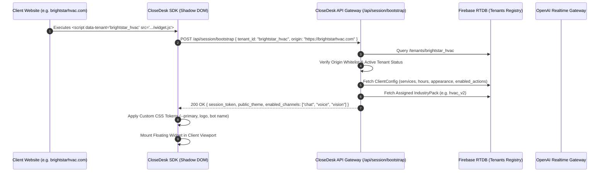

# Multi-Tenant Headless & Portable Architecture Specification: CloseDesk

**Document:** Multi-Tenant Platform & Portable Widget Architecture  
**Product:** CloseDesk by Aicyro  
**Version:** 2.0 (Multi-Tenant Enterprise Specification)  
**Reference Specification:** CloseDesk End-to-End Chatbot Architecture & Implementation Specification (v1.0) & [SUBSYSTEM_ARCHITECTURE.md](file:///d:/Software%20House%2001/CloseDesk-Aicyro-GIT/SUBSYSTEM_ARCHITECTURE.md)  
**Architectural Goal:** Completely decouple the conversational front-desk and operational control plane from any specific marketing website, enabling CloseDesk's **Multimodal Chatbot Widget** and **Pulse Operations Dashboard** to be deployed across *any* external client website (WordPress, Webflow, Shopify, custom React/Next.js, etc.) with strict multi-tenant isolation.

---

## 1. Architectural Transformation & Decoupling Strategy

### 1.1 The Monolithic vs. Multi-Tenant Headless Model

In the single-tenant model, the public marketing pages, dashboard, and chatbot widget were co-located inside a single Next.js application (`CloseDesk-Aicyro-GIT`). 

In this **Multi-Tenant Headless Architecture**, the platform is decoupled into three independent layers:

```text
+---------------------------------------------------------------------------------------------------------+
|                                    EXTERNAL CLIENT WEBSITES (ANY HOST)                                  |
|                                                                                                         |
|   +--------------------------+    +--------------------------+    +---------------------------------+   |
|   |   BrightStar HVAC        |    |   Apex Emergency Plumbing|    |   Custom Next.js Marketing App  |   |
|   |   (WordPress / WPEngine) |    |   (Webflow / Cloudflare) |    |   (Vercel / Netlify)            |   |
|   |                          |    |                          |    |                                 |   |
|   |   <script ...            |    |   <script ...            |    |   <CloseDeskWidget              |   |
|   |     data-tenant="bstar"> |    |     data-tenant="apex">  |    |     tenantId="demo" />          |   |
|   +------------+-------------+    +------------+-------------+    +----------------+----------------+   |
+----------------|-------------------------------|-----------------------------------|--------------------+
                 |                               |                                   |
                 +-------------------------------+-----------------------------------+
                                                 | Embeds Widget via CDN / Script Tag
                                                 v
+---------------------------------------------------------------------------------------------------------+
|                                  CLOSEDESK CENTRALIZED SAAS PLATFORM                                    |
|                                                                                                         |
|   +-------------------------------------------------------------------------------------------------+   |
|   | 1. PORTABLE WIDGET RUNTIME (cdn.closedesk.ai/widget.js)                                         |   |
|   |    - Shadow DOM UI Shell (Zero CSS conflicts)       - WebRTC Audio Stream (24kHz PCM)           |   |
|   |    - Full-Duplex Voice Engine                       - Multimodal Camera / Image Compression     |   |
|   +-------------------------------------------------------------------------------------------------+   |
|                                                |                                                        |
|                                                v                                                        |
|   +-------------------------------------------------------------------------------------------------+   |
|   | 2. HEADLESS MULTI-TENANT BACKEND & API GATEWAY (api.closedesk.ai)                               |   |
|   |    - Tenant Resolver & Origin Validator             - Session Manager (Channel-Independent)     |   |
|   |    - Three-Tier Config Loader (Core + Pack + Tenant)- Canonical Tool Router & Idempotency Engine|   |
|   |    - Scoped Vector RAG / Knowledge Store            - WebRTC Ephemeral Secret Minter            |   |
|   +-------------------------------------------------------------------------------------------------+   |
|                                                |                                                        |
|                                                v                                                        |
|   +-------------------------------------------------------------------------------------------------+   |
|   | 3. PULSE OPERATIONS & CONTROL PLANE (app.closedesk.ai)                                          |   |
|   |    - Master SuperAdmin Portal (Client Onboarding, Industry Packs, Global Email/SMS Relays)      |   |
|   |    - Tenant Pulse Cockpit (/lg) (Live Lead Triage, Booking Calendar, Audio Transcripts, Insights|   |
|   |    - Scoped Realtime WebSockets (Firebase RTDB multi-tenant partition)                          |   |
|   +-------------------------------------------------------------------------------------------------+   |
+---------------------------------------------------------------------------------------------------------+
                                                 |
                                                 v
+---------------------------------------------------------------------------------------------------------+
|                                    THIRD-PARTY INTEGRATIONS (BY TENANT)                                 |
|                                                                                                         |
|       ServiceTitan API           Jobber Webhooks           Housecall Pro          HubSpot / HighLevel   |
+---------------------------------------------------------------------------------------------------------+
```

### 1.2 Core Separation Principles
1. **The Marketing Website is Discardable & Replaceable:**  
   The marketing site (`src/pages/index.jsx`, `free-website-audit.jsx`, etc.) becomes just one consumer of the platform. Any client can replace it entirely with their existing corporate site.
2. **One Brain, Many Configurations:**  
   A single shared conversational engine powers all clients. Differences in trades, policies, working hours, booking rules, and voice profiles are 100% configuration-driven.
3. **Core Formula:**  
   $$\text{Conversational Experience} = \text{CloseDesk Core} + \text{Industry Pack} + \text{Client Config} + \text{Client Knowledge} + \text{Tenant Tools/APIs}$$
4. **Tenant Isolation Everywhere:**  
   No client can ever access another client's configuration, session memory, customer PII, transcripts, or CRM credentials.

---

## 2. Multi-Tenant Identity, Bootstrap & Security Model

### 2.1 The Bootstrap Lifecycle
When the CloseDesk widget loads on an external client website, it undergoes a secure handshake to resolve the tenant without exposing backend credentials:



### 2.2 Security & Origin Validation
* **Domain Whitelisting:** Each tenant record in the database maintains an `allowed_origins` array (e.g., `["https://brightstarhvac.com", "https://staging.brightstarhvac.com"]`). If the bootstrap request originates from an unauthorized domain, the gateway immediately returns `403 Forbidden`.
* **Signed Bootstrap Tokens:** The backend issues a short-lived, signed JWT (`session_token`) encapsulating `{ tenant_id, session_id, allowed_tools }`. All subsequent chat, voice, and vision API requests must present this bearer token.
* **Zero Client Secrets:** The external client snippet never holds OpenAI API keys, Firebase service credentials, or CRM auth tokens.

---

## 3. Portable Widget SDK Architecture (`cdn.closedesk.ai/widget.js`)

To embed CloseDesk on any website without breaking host CSS or JavaScript, the widget is packaged as an encapsulated Web SDK.

### 3.1 Encapsulation via Shadow DOM
The widget is injected into an isolated `ShadowRoot` (`mode: "closed"`):
```javascript
// Runtime Widget Bootstrapper
class CloseDeskWidgetElement extends HTMLElement {
  connectedCallback() {
    const shadow = this.attachShadow({ mode: "closed" });
    const container = document.createElement("div");
    container.id = "closedesk-root";

    // Inject isolated Tailwind CSS stylesheet inside Shadow Root
    const styleLink = document.createElement("link");
    styleLink.rel = "stylesheet";
    styleLink.href = "https://cdn.closedesk.ai/widget.css";
    shadow.appendChild(styleLink);
    shadow.appendChild(container);

    // Mount React 19 root into shadow container
    const root = ReactDOM.createRoot(container);
    root.render(<AicyroChatbot tenantId={this.dataset.tenant} sessionToken={this.dataset.token} />);
  }
}
customElements.define("closedesk-widget", CloseDeskWidgetElement);
```
**Benefits:**
* **Zero CSS Bleeding:** Host site styles (`h1`, `button`, resets) cannot distort the widget; widget styles cannot break the host page.
* **Framework Agnostic:** Works natively on WordPress, Webflow, Squarespace, Wix, Shopify, or pure HTML.

### 3.2 Universal CMS Deployment Snippets

#### A. Standard HTML / CMS Tag (WordPress, Webflow, Wix, Squarespace)
Place immediately before the closing `</body>` tag:
```html
<!-- CloseDesk Multimodal AI Front-Desk -->
<script 
  src="https://cdn.closedesk.ai/widget.js" 
  data-tenant="brightstar_hvac" 
  data-position="bottom-right" 
  data-primary-color="#0284c7"
  defer>
</script>
```

#### B. Modern React / Next.js Component Wrapper (`@closedesk/react`)
For modern web applications wanting deep programmatic control:
```tsx
import { CloseDeskChat } from "@closedesk/react";
import "@closedesk/react/dist/index.css";

export default function Layout({ children }) {
  return (
    <>
      <main>{children}</main>
      <CloseDeskChat 
        tenantId="brightstar_hvac" 
        position="bottom-right"
        defaultChannel="voice"
        onLeadCaptured={(lead) => console.log("Lead captured:", lead)}
      />
    </>
  );
}
```

---

## 4. The Three-Tier Configuration Engine

The conversation intelligence layer separates platform capabilities, domain knowledge, and client rules into three versioned layers:

```text
                                  CONVERSATION INTELLIGENCE
                                              │
         ┌────────────────────────────────────┼────────────────────────────────────┐
         │                                    │                                    │
         ▼                                    ▼                                    ▼
[Tier 1: CloseDesk Core]            [Tier 2: Industry Pack]              [Tier 3: Client Config]
  Platform-wide behavior & safety     Trade-specific taxonomy & rules      Tenant-specific parameters
  * One question at a time            * HVAC, Plumbing, Restoration, etc. * Business name & branding
  * Answer before interrogating       * Urgency detection (gas leak, burst)* Operating hours & timezone
  * Context before questions          * Discovery guidance & terminology   * Service area ZIP codes
  * State machine & tool protocols    * Permitted actions by trade         * Action flags (booking: true)
  * PII masking & telemetry specs     * Industry regression test suites    * CRM adapter & voice profile
```

### 4.1 Tier 1: CloseDesk Core Engine
Maintained in [src/lib/ruleBook.js](file:///d:/Software%20House%2001/CloseDesk-Aicyro-GIT/src/lib/ruleBook.js). Enforces the platform state machine:
```text
GREETING 
  └── INTENT_DISCOVERY 
        ├── BUSINESS_DISCOVERY 
        ├── PROBLEM_DISCOVERY 
        │     └── SOLUTION_MAPPING 
        │           └── ACTION_READY 
        │                 ├── CONTACT_CAPTURE 
        │                 └── TOOL_EXECUTION 
        │                       └── COMPLETE
        ├── OBJECTION ──> SOLUTION_MAPPING
        ├── HUMAN_HANDOFF ──> COMPLETE
        └── ANONYMOUS ──> COMPLETE
```
* **Core Non-Negotiables:**
  * Direct user questions are answered before unrelated qualification continues.
  * Never ask for information already provided in the current session.
  * Operational actions (booking, dispatch) are never confirmed until the backend API returns success.

### 4.2 Tier 2: Industry Packs (Versioned Domain Intelligence)
Industry packs are versioned JSON configurations stored in `/industry_packs/{industry_pack_id}`:
```json
{
  "id": "hvac_v2",
  "industry": "hvac",
  "version": "2.4.0",
  "service_types": ["ac_repair", "heating_maintenance", "furnace_replacement", "heat_pump", "ductless_mini_split"],
  "problem_taxonomy": {
    "no_cooling": ["system_running_warm_air", "system_dead", "breaker_tripping", "frozen_coils"],
    "water_leak": ["condensate_pan_overflow", "drain_line_clogged", "frozen_evaporator_thaw"]
  },
  "urgency_signals": [
    {"pattern": "burning smell", "urgency": "emergency", "safety_directive": "Advise turning system off at breaker immediately."},
    {"pattern": "carbon monoxide alarm", "urgency": "emergency", "safety_directive": "Advise immediate evacuation and calling 911."}
  ],
  "discovery_fields_by_intent": {
    "no_cooling": ["is_fan_running", "air_blowing_from_vents", "thermostat_responsive"]
  },
  "allowed_actions": ["check_serviceability", "get_availability", "create_booking", "create_service_request", "request_callback"],
  "regression_suite_id": "hvac_regression_v2"
}
```

### 4.3 Tier 3: Client Tenant Configuration
Stored in Firebase RTDB at `/tenants/{tenant_id}/config`:
```json
{
  "tenant_id": "brightstar_hvac",
  "business_name": "BrightStar Heating & Air",
  "industry_pack": "hvac_v2",
  "timezone": "America/New_York",
  "business_hours": {
    "mon_fri": {"start": "08:00", "end": "18:00"},
    "sat": {"start": "09:00", "end": "14:00"},
    "sun": {"emergency_only": true}
  },
  "after_hours_policy": "emergency_dispatch_available",
  "service_area": {
    "type": "zip_codes",
    "values": ["30301", "30302", "30303", "30305", "30308", "30309"]
  },
  "actions": {
    "booking": true,
    "service_request": true,
    "quote": false,
    "inspection": true,
    "callback": true
  },
  "contact_requirements": {
    "mandatory": ["phone", "address"],
    "optional": ["email", "preferred_window"]
  },
  "pricing_policy": "do_not_quote_unless_knowledge_grounded",
  "integration_profile": "servicetitan_prod_01",
  "voice_profile": "alloy",
  "knowledge_version": 14,
  "enabled": true
}
```

---

## 5. Canonical Tool & Integration Adapter Layer

CloseDesk decouples conversational logic from external CRMs. The AI model only interacts with **canonical tools**. Backend adapters translate these into vendor-specific API payloads.

```text
                  AI MODEL / WEBRTC DATACHANNEL
                                │
               Fires: create_booking(canonical_payload)
                                │
                                v
               CLOSEDESK CANONICAL TOOL ROUTER
                                │
            Resolves: Tenant's integration_profile
                                │
         ┌──────────────────────┼──────────────────────┐
         │                      │                      │
         ▼                      ▼                      ▼
[ServiceTitan Adapter]    [Jobber Adapter]    [Generic Webhook Adapter]
  Maps to POST /jobs        Maps to /graphql    Maps to POST /api/leads
  Auth: OAuth2 Bearer       Auth: API Key       Auth: HMAC SHA-256
```

### 5.1 Canonical Tool Specification
| Canonical Tool | Purpose | Required Inputs |
| :--- | :--- | :--- |
| `check_serviceability` | Validates if customer ZIP code is covered | `tenant_id`, `zip_code` |
| `get_availability` | Fetches open dispatch slots from CRM | `tenant_id`, `service_type`, `date_range` |
| `create_booking` | Confirms real calendar slot | `tenant_id`, `contact`, `service`, `slot_id`, `idempotency_key` |
| `create_service_request`| Creates unassigned ticket / emergency job | `tenant_id`, `contact`, `issue`, `urgency`, `idempotency_key` |
| `request_callback` | Queues immediate human dispatcher callback | `tenant_id`, `phone_number`, `reason`, `preferred_time` |
| `human_handoff` | Hot-transfers conversation to live human desk | `tenant_id`, `session_summary`, `urgency` |

### 5.2 Idempotency & Fault Tolerance
Every state-mutating tool (`create_booking`, `create_service_request`) requires an `idempotency_key` formatted as:
$$\text{idempotency\_key} = \text{hash}(\text{session\_id} + \text{tool\_name} + \text{requested\_slot\_or\_phone})$$
If a network timeout occurs between CloseDesk and ServiceTitan, retrying the call with the same idempotency key guarantees the customer will **never receive a duplicate appointment or bill**.

---

## 6. Pulse Multi-Tenant Dashboard Architecture (`/lg`)

The Pulse Dashboard is transformed into a **Multi-Tenant SaaS Operations Center**. It can run on a centralized URL (`https://app.closedesk.ai`) or custom tenant domains (`https://dispatch.brightstarhvac.com` via CNAME).

```text
                                  PULSE CONTROL PLANE
                                            │
         ┌──────────────────────────────────┴──────────────────────────────────┐
         │                                                                     │
         ▼                                                                     ▼
[Master SuperAdmin View]                                              [Tenant Workspace View]
(Platform Owner / Engineering)                                        (Contractor Dispatcher / Owner)
  * Tenant Lifecycle & CRUD Provisioning                                * Real-Time Emergency Triage Queue
  * Industry Pack Registry & Policy Editor                              * Field Booking Calendar & Route Map
  * Master SMTP / SMS Relay Protocol Config                             * Full-Duplex Audio & Transcript Browser
  * Cross-Tenant Observability & Token Usage                            * Business Hours & Skill Customizer
```

### 6.1 SuperAdmin: Multi-Tenant Provisioning Workflow
Located in [src/components/Dashboard/superadmin/](file:///d:/Software%20House%2001/CloseDesk-Aicyro-GIT/src/components/Dashboard/superadmin/):
1. **Tenant Onboarding Wizard:**
   * Enter `tenant_id`, Company Name, and Primary Admin Email.
   * Select Industry Pack (`hvac_v2`, `plumbing_v2`, etc.).
   * Configure Whitelisted Domains (e.g. `clientwebsite.com`).
   * System generates public embedding snippet and cryptographically securely hashes initial tenant admin credentials.
2. **Global Communication Protocols:**
   * [SuperAdminEmailProtocol.jsx](file:///d:/Software%20House%2001/CloseDesk-Aicyro-GIT/src/components/Dashboard/superadmin/Settings/SuperAdminEmailProtocol.jsx) manages shared outbound relays (Microsoft 365 OAuth2, Google Workspace, AWS SES, SendGrid).

### 6.2 Tenant Admin: Isolated Operations Cockpit
When a tenant logs in at `app.closedesk.ai/lg`, their authenticated session binds `tenant_id` to all view components:
* **Inbound Triage ([TerminalScreen.jsx](file:///d:/Software%20House%2001/CloseDesk-Aicyro-GIT/src/components/Dashboard/TerminalScreen.jsx)):**  
  Listens exclusively to `/tenants/{tenant_id}/leads`. Real-time WebSocket triggers flash urgent leads in red, trigger audio chimes, and allow 1-click callback phone dialer actions.
* **Appointments & Dispatch ([Booking.jsx](file:///d:/Software%20House%2001/CloseDesk-Aicyro-GIT/src/components/Dashboard/Booking.jsx)):**  
  Listens exclusively to `/tenants/{tenant_id}/bookings`. Dispatchers confirm, reschedule, or reassign field appointments.
* **Conversations & Transcripts ([Conversations.jsx](file:///d:/Software%20House%2001/CloseDesk-Aicyro-GIT/src/components/Dashboard/Conversations.jsx)):**  
  Subscribes to `/tenants/{tenant_id}/transcripts`. Allows listening to voice session replays, viewing vision inspection photos, and reviewing tool call history.
* **Branding & Voice Profile ([apearance.jsx](file:///d:/Software%20House%2001/CloseDesk-Aicyro-GIT/src/components/Dashboard/Settings/apearance.jsx)):**  
  Tenants adjust their public widget accent color, upload custom avatar logos, and select voice personas (Alloy, Echo, Shimmer, Coral, Ash). Changes immediately propagate to their external embedded widget via Firebase WebSockets.

---

## 7. Multi-Tenant Database Partitioning Schema

The Firebase Realtime Database is partitioned strictly by `tenant_id`. Cross-tenant querying is physically prevented by database structure and security rules:

```text
/
├── tenants/
│   └── {tenant_id}/
│       ├── config/                         # ClientConfig (Hours, services, service area, policies)
│       ├── appearance/                     # Theme variables (primary color, logo, bot name)
│       ├── users/                          # Tenant admin credentials & hashed passwords
│       ├── leads/
│       │   └── {sessionId}/                # Qualified customer leads & contact info
│       ├── bookings/
│       │   └── {bookingId}/                # Scheduled appointments & calendar slots
│       ├── transcripts/
│       │   └── {sessionId}/                # Full text transcripts & tool execution logs
│       ├── analytics/
│       │   └── visitors/{visitorId}/       # Anonymized visitor telemetry & hardware profiles
│       ├── knowledge/
│       │   └── {knowledgeId}/              # Tenant-scoped FAQ, pricing & service grounding
│       └── email_alerts/
│           └── {alertId}/                  # Outbound notification queue for Cloud Functions
│
├── industry_packs/
│   └── {industry_pack_id}/                 # Versioned domain rules (HVAC, Plumbing, Restoration)
│
├── system/
│   ├── superadmins/                        # Master superadmin credentials
│   └── global_config/                      # Shared email/SMS relay configurations
│
└── audit_logs/
    └── {logId}/                            # Immutable SOC2 audit trail (tenant_id, action, timestamp)
```

### 7.1 Firebase Security Rules Partition
```json
{
  "rules": {
    "tenants": {
      "$tenant_id": {
        ".read": "auth != null && (auth.token.tenant_id === $tenant_id || auth.token.is_superadmin === true)",
        ".write": "auth != null && (auth.token.tenant_id === $tenant_id || auth.token.is_superadmin === true)"
      }
    },
    "industry_packs": {
      ".read": "true",
      ".write": "auth != null && auth.token.is_superadmin === true"
    }
  }
}
```

---

## 8. Client Onboarding & Deployment Playbook

Below is the standard 10-minute deployment process for onboarding a new home-service business onto CloseDesk and embedding it on their existing website:

```text
                               10-MINUTE ONBOARDING PLAYBOOK
                                             │
      ┌──────────────────────────────────────┼──────────────────────────────────────┐
      │                                      │                                      │
      ▼                                      ▼                                      ▼
[Phase 1: SuperAdmin Setup]         [Phase 2: Tenant Rules]               [Phase 3: Client Embed]
  1. Login to /lg superadmin         4. Set business hours & timezone      7. Copy generated snippet
  2. Create Tenant (e.g. Apex)       5. Input service area ZIP codes       8. Paste in client website HTML
  3. Assign "plumbing_v2" pack       6. Set emergency dispatch phone       9. Test voice & verify on Pulse
```

### Step-by-Step Procedure:

1. **Step 1: SuperAdmin Provisions Tenant (`/lg #superadmin`)**  
   * Superadmin opens `ClientManagement.jsx`, clicks **New Client**, enters `apex_plumbing` and adds their live domain (`https://apexplumbing.com`).
   * Selects Industry Pack `plumbing_v2`.
   * Clicks **Generate Credentials**. The system provisions the tenant partition in Firebase.

2. **Step 2: Tenant Configures Operations (`/lg #settings`)**  
   * Tenant logs into `app.closedesk.ai/lg` with temporary credentials.
   * In **Business Profile**, they define working hours (e.g., Mon–Sat 7am–7pm) and emergency phone numbers for after-hours dispatch.
   * In **Appearance**, they pick their brand blue `#0284c7` and select their preferred voice (e.g., `shimmer`).
   * In **Chatbot Settings**, they paste custom FAQs (e.g. *"We do not service commercial grease traps"*).

3. **Step 3: Embed Snippet on Client Website**  
   * The contractor or their webmaster copies the embed code from their Pulse settings:
     ```html
     <script 
       src="https://cdn.closedesk.ai/widget.js" 
       data-tenant="apex_plumbing" 
       defer>
     </script>
     ```
   * Pastes it into WordPress (via *WPCode* or header/footer plugin), Webflow (*Site Settings > Custom Code*), Squarespace, or Shopify.

4. **Step 4: End-to-End Verification**  
   * The contractor visits `apexplumbing.com`, clicks the floating front-desk icon, and tests a live voice call: *"I have an emergency burst pipe in my basement."*
   * The AI diagnoses the leak, confirms serviceability in their ZIP code, captures the customer's phone number, and records the lead.
   * The contractor's phone chimes immediately, and the lead flashes on their **Pulse Terminal** (`/lg`). Deployment is complete.
