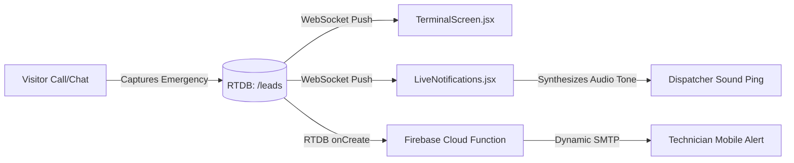
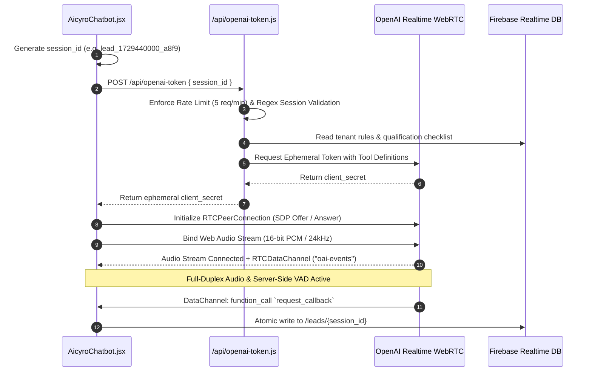

# Subsystem Architecture Specification: CloseDesk (Aicyro)

**Architectural Role:** Senior Web Architect  
**Project:** CloseDesk (Branded as Aicyro)  
**Workspace:** `CloseDesk-Aicyro-GIT`  
**Document Purpose:** Detailed separate architectural specifications for the three foundational subsystems:
1. [Subsystem 1: Public Marketing & Conversion Architecture](#subsystem-1-public-marketing--conversion-architecture)
2. [Subsystem 2: Pulse Dashboard Architecture (Tenant & Super Admin)](#subsystem-2-pulse-dashboard-architecture-tenant--super-admin)
3. [Subsystem 3: CloseDesk Multimodal Chatbot Widget Architecture](#subsystem-3-closedesk-multimodal-chatbot-widget-architecture)

---

# Subsystem 1: Public Marketing & Conversion Architecture

The public marketing subsystem is engineered for sub-second First Contentful Paint (FCP), zero cumulative layout shift (CLS), strict search engine optimization (SEO), and conversion capture for home-service enterprises.

```text
                                  PUBLIC MARKETING LAYER
                                             │
      ┌──────────────────────────────────────┼──────────────────────────────────────┐
      │                                      │                                      │
      ▼                                      ▼                                      ▼
[Page Shell & Layout]              [Conversion Funnels]                   [Telemetry & SEO]
  _app.jsx                           Hero.jsx (Above-the-fold)              Seo.jsx (JSON-LD Schema)
  _document.jsx (Anti-FOUC)          NightScene.jsx (24/7 Simulator)        CookieConsentBanner.jsx
  layout.jsx (Widget Wrapper)        Pricing.jsx (Interactive ROI)         GlobalActivityTracker.jsx
  Navbar.jsx / Footer.jsx            Popupform.jsx (Multi-step Modal)       activityTracker.js
                                     free-website-audit.jsx (Wizard/PDF)    cookiePersonalization.js
```

### 1.1 Rendering Strategy & Performance Engine
* **Hybrid Static Site Generation (SSG) with Dynamic Hydration:**  
  All public pages (`/`, `/privacy`, `/cookie`, `/termofuse`, `/free-website-audit`) are compiled at build-time using Next.js Pages Router. The HTML markup is instantly served via CDN edges.
* **Anti-FOUC Theme Script (`_document.jsx`):**  
  An inline, blocking vanilla JavaScript snippet executes in the HTML `<head>` before the DOM renders. It reads `localStorage.getItem("theme")` or queries `window.matchMedia("(prefers-color-scheme: dark)")` and immediately injects the `dark` class on the root `<html>` element, preventing visual flashes of unstyled content.
* **Non-Blocking Dynamic Widget Mount (`layout.jsx`):**  
  `layout.jsx` acts as a route-aware shell. It inspects `router.pathname` and conditionally mounts `AicyroChatbot.jsx` across all public marketing pages while omitting it on operational routes (`/lg`, `/logs`). This guarantees that heavy WebRTC/media dependencies do not affect initial page parsing.

### 1.2 Component Hierarchy & Conversion Funnel
```text
src/pages/index.jsx (Marketing Root)
│
├── Essential/Seo.jsx ...................... OpenGraph, Twitter Cards, Canonical URLs & LocalBusiness Schema
├── Essential/Navbar.jsx ................... Sticky Header, Mobile Drawer, Call-To-Action (CTA) triggers
│
├── [Conversion Flow Sections]
│   ├── Home/Hero.jsx ...................... Value proposition, dynamic headline typography & audit CTA
│   ├── Home/NightScene.jsx ................ Interactive simulation demonstrating after-hours revenue capture
│   ├── Home/TheTurn.jsx ................... Comparative positioning: passive voicemail vs. active AI closer
│   ├── Home/Problem.jsx ................... Missed-call revenue loss calculator for contractors
│   ├── Home/Pricing.jsx ................... Tier selector with estimated monthly ROI calculator
│   ├── Home/Compare.jsx ................... Feature comparison matrix: CloseDesk vs. traditional call centers
│   ├── Home/NotFor.jsx .................... Anti-persona qualification to improve inbound lead quality
│   ├── Home/Offer.jsx ..................... Deliverables, setup timeline, and 30-day guarantee
│   ├── Home/Trust.jsx ..................... 99.9% uptime SLA, security compliance & customer testimonials
│   ├── Home/Faq.jsx ....................... Expandable accordion FAQ addressing technical/operational questions
│   └── Home/Cta.jsx ....................... Final bottom conversion banner with direct lead capture trigger
│
├── Form/Popupform.jsx ..................... Modal lead capture wizard writing directly to RTDB /leads
├── Essential/CookieConsentBanner.jsx ...... CCPA/GDPR consent gate managing telemetry transmission
└── Essential/Footer.jsx ................... Legal disclosures, sitemap navigation, and company credentials
```

### 1.3 Interactive Diagnostic Subsystem (`/free-website-audit`)
* **16-Step Diagnostic Wizard:**  
  A dedicated conversion engine ([free-website-audit.jsx](file:///d:/Software%20House%2001/CloseDesk-Aicyro-GIT/src/pages/free-website-audit.jsx)) that steps prospects through operational audits (call handling, lead capture latency, mobile responsiveness).
* **Automated PDF Generation (`jspdf`):**  
  Upon quiz completion, the client triggers `/api/generate-audit`. It compiles an executive audit scorecard, invokes `jspdf` on the client to render a branded multi-page PDF report, and simultaneously provisions a lead entry in `/leads` with channel `website_audit`.

### 1.4 Client Telemetry & Regulatory Compliance
* **Consent-Gated Telemetry:**  
  [cookiePersonalization.js](file:///d:/Software%20House%2001/CloseDesk-Aicyro-GIT/src/lib/cookiePersonalization.js) enforces strict GDPR/CCPA compliance. If consent is declined or unacknowledged, analytics cookies are suppressed.
* **Behavioral Activity Tracker:**  
  [activityTracker.js](file:///d:/Software%20House%2001/CloseDesk-Aicyro-GIT/src/lib/activityTracker.js) and [GlobalActivityTracker.jsx](file:///d:/Software%20House%2001/CloseDesk-Aicyro-GIT/src/components/GlobalActivityTracker.jsx) monitor scroll depth, section dwell time, and button interactions, pushing anonymized sessions to Firebase RTDB `/analytics/visitors` and reporting uncaught frontend errors.

---

# Subsystem 2: Pulse Dashboard Architecture (Tenant & Super Admin)

The Pulse Dashboard (`/lg`) serves as the operational nerve center. It provides a real-time Single Page Application (SPA) with dual role-based access control (RBAC): **Tenant Admin** (day-to-day triage, scheduling, analytics) and **Master Super Admin** (multi-tenant provisioning and infrastructure protocols).

```text
                                  PULSE WORKSPACE (/lg)
                                            │
         ┌──────────────────────────────────┴──────────────────────────────────┐
         │                                                                     │
         ▼                                                                     ▼
[Tenant Admin Portal]                                                 [Super Admin Portal]
  HomeScreen.jsx (KPIs)                                                 SuperAdminDashboard.jsx (Shell)
  TerminalScreen.jsx (Lead Triage)                                      ClientManagement.jsx (Tenant CRUD)
  Conversations.jsx (Transcripts & Audio)                               SuperAdminAppearance.jsx (Global)
  Booking.jsx (Calendar & Dispatch)                                     SuperAdminEmailProtocol.jsx (SMTP)
  Insight.jsx (Recharts BI Visuals)                                     superadminlogin.jsx (Privileged Gate)
  LiveNotifications.jsx (Alerts & Audio Pings)
  CookieDataDisplay.jsx (Google Maps Cluster)
  Settings/ (Chatbot, Hours, SMTP, Passwords)
```

### 2.1 Access Control & Client-Side SPA Architecture
* **Single Route Mount (`/lg.jsx`):**  
  All administrative capabilities reside under [src/pages/lg.jsx](file:///d:/Software%20House%2001/CloseDesk-Aicyro-GIT/src/pages/lg.jsx). View navigation is executed via internal view states (`activeTab`), preventing full page reloads and preserving WebSocket subscriptions.
* **Cryptographic Authentication Gate:**  
  Tenant administrators authenticate against `/api/login`, which validates credentials against RTDB `/users/{username}` using secure hash comparisons. Session tokens are stored in `sessionStorage` and attached to privileged API calls.
* **Superadmin Route Isolation:**  
  The Master Superadmin view requires an elevated passkey validated by `superadminlogin.jsx`. Superadmins gain cross-tenant visibility and protocol configuration rights.

### 2.2 Tenant Administration Architecture
The tenant interface is composed of high-density operational modules:

1. **Executive KPI Cockpit ([HomeScreen.jsx](file:///d:/Software%20House%2001/CloseDesk-Aicyro-GIT/src/components/Dashboard/HomeScreen.jsx)):**  
   Binds direct listeners to RTDB nodes `/analytics`, `/leads`, and `/bookings`. Automatically aggregates pipeline metrics: total lead volume, active online visitors, conversion velocity, and estimated closed revenue.
2. **Inbound Triage Terminal ([TerminalScreen.jsx](file:///d:/Software%20House%2001/CloseDesk-Aicyro-GIT/src/components/Dashboard/TerminalScreen.jsx)):**  
   Designed for emergency dispatchers. Leads stream into a high-density triage queue, prioritized by urgency tags (`emergency`, `high`, `normal`, `low`). Dispatchers can update triage statuses (`new` → `contacted` → `scheduled` → `archived`), trigger one-click phone dialers, and filter by trade category.
3. **Multimodal Conversation Explorer ([Conversations.jsx](file:///d:/Software%20House%2001/CloseDesk-Aicyro-GIT/src/components/Dashboard/Conversations.jsx)):**  
   Subscribes to `/transcripts` and `/prospects`. Displays full message dialogues, audio session durations, WebRTC tool execution events, customer sentiment, and attached defect photos uploaded during the session.
4. **Field Scheduling Dispatcher ([Booking.jsx](file:///d:/Software%20House%2001/CloseDesk-Aicyro-GIT/src/components/Dashboard/Booking.jsx)):**  
   Visual calendar and slot manager synchronized with `/bookings`. Enables dispatchers to confirm, reschedule, or cancel field consultations generated by the AI assistant.
5. **Business Intelligence Engine ([Insight.jsx](file:///d:/Software%20House%2001/CloseDesk-Aicyro-GIT/src/components/Dashboard/Insight.jsx)):**  
   Integrates with `/api/insights` and `recharts` to render conversion funnels, after-hours call distribution histograms, and customer objection radar charts.
6. **Visitor Spatial Telemetry ([CookieDataDisplay.jsx](file:///d:/Software%20House%2001/CloseDesk-Aicyro-GIT/src/components/Dashboard/CookieDataDisplay.jsx)):**  
   Integrates `@vis.gl/react-google-maps` ([CookieMap.jsx](file:///d:/Software%20House%2001/CloseDesk-Aicyro-GIT/src/components/Dashboard/cookie/CookieMap.jsx)) and data tables ([CookieGrid.jsx](file:///d:/Software%20House%2001/CloseDesk-Aicyro-GIT/src/components/Dashboard/cookie/CookieGrid.jsx)) to cluster visitor traffic geographically and inspect device/browser fingerprints.
7. **Modular Tenant Settings ([Settings/](file:///d:/Software%20House%2001/CloseDesk-Aicyro-GIT/src/components/Dashboard/Settings/)):**  
   * [Chatbotsetting.jsx](file:///d:/Software%20House%2001/CloseDesk-Aicyro-GIT/src/components/Dashboard/Settings/Chatbotsetting.jsx): Customizes AI assistant personality, qualification questionnaires, and voice selection. Includes live voice preview via `/api/tts`.
   * [BusinessProfile.jsx](file:///d:/Software%20House%2001/CloseDesk-Aicyro-GIT/src/components/Dashboard/Settings/BusinessProfile.jsx): Configures operating hours, emergency dispatch phone numbers, and service territories.
   * [notification-settings.jsx](file:///d:/Software%20House%2001/CloseDesk-Aicyro-GIT/src/components/Dashboard/Settings/notification-settings.jsx): Configures dispatch routing gates (urgentOnly, afterHours) and outbound SMTP accounts.
   * [apearance.jsx](file:///d:/Software%20House%2001/CloseDesk-Aicyro-GIT/src/components/Dashboard/Settings/apearance.jsx): Customizes primary color accents and dark/light themes.

### 2.3 Master Superadmin Architecture
Located in [src/components/Dashboard/superadmin/](file:///d:/Software%20House%2001/CloseDesk-Aicyro-GIT/src/components/Dashboard/superadmin/):

* **Tenant Client Provisioning ([ClientManagement.jsx](file:///d:/Software%20House%2001/CloseDesk-Aicyro-GIT/src/components/Dashboard/superadmin/ClientManagement.jsx)):**  
  Enables platform owners to create new tenant partitions, generate administrative credentials, toggle account activation states, and inspect cross-tenant performance metrics.
* **Email Protocol Engine ([SuperAdminEmailProtocol.jsx](file:///d:/Software%20House%2001/CloseDesk-Aicyro-GIT/src/components/Dashboard/superadmin/Settings/SuperAdminEmailProtocol.jsx)):**  
  Centralized mail protocol coordinator configuring dynamic Nodemailer transports in Cloud Functions (`functions/index.js`). Pre-configures profiles for:
  * Hostinger, Namecheap & cPanel custom SMTP relays.
  * Microsoft 365 (Modern OAuth2 via `smtp-mail.outlook.com` with client credentials flow).
  * Google Workspace OAuth2.

### 2.4 Real-Time Data Flow & Dispatch Alerts


---

# Subsystem 3: CloseDesk Multimodal Chatbot Widget Architecture

The CloseDesk Chatbot Widget ([AicyroChatbot.jsx](file:///d:/Software%20House%2001/CloseDesk-Aicyro-GIT/src/components/Chatbot/AicyroChatbot.jsx)) is an all-in-one multimodal front-desk agent supporting **low-latency WebRTC voice**, **structured chat completion**, and **computer vision defect diagnosis**.

```text
                              AICYRO CHATBOT WIDGET
                                       │
        ┌──────────────────────────────┼──────────────────────────────┐
        │                              │                              │
        ▼                              ▼                              ▼
[Pipeline A: WebRTC Voice]     [Pipeline B: Text Chat]      [Pipeline C: AI Vision]
  Web Audio API (24kHz PCM)      OpenAI JSON Mode             Browser Camera / File Input
  OpenAI Realtime Gateway        ruleBook.js (v2.11.0)        Canvas Downscale / WebP
  DataChannel Tool Execution     safeJsonParse Tracing        Firebase Storage Upload
  Sub-100ms Latency              Quick-Reply Suggestions      GPT-4o-mini Vision Defect Run
```

### 3.1 Pipeline A: Real-Time WebRTC Full-Duplex Voice Engine
Enables natural, sub-100ms conversational phone/voice interactions with no server audio buffering.



* **Voice Activity Detection (VAD) Tuning:**  
  Configured in `/api/openai-token.js` with server-side turn detection (`type: "server_vad"`), prefix padding (`300ms`), and silence cutoff (`500ms`), allowing customers to speak naturally and interrupt the bot smoothly.
* **Tool Calling Capabilities:**  
  The voice model has access to discrete function tools executed on the client:
  * `request_callback(phone_number, name)`
  * `request_consultation(preferred_date, preferred_time)`
  * `request_website_audit(website_url, email)`
  * `record_privacy_preference(refused_fields)`
  * `request_data_deletion()`

### 3.2 Pipeline B: Conversational Chat Completion
* **System Policy Enforcement (`ruleBook.js` v2.11.0):**  
  Every chat request to `/api/chat` injects strict domain instructions:
  * **Emergency Protocol:** Immediately escalates gas leaks, active pipe bursts, or electrical hazards.
  * **Zero-Hallucination Guardrail:** Prohibits quoting unverified binding pricing; restricts answers to verified tenant services.
  * **Information Collection Checklist:** Progressively collects name, address, phone number, and problem description.
* **Structured JSON Schema Mode:**  
  OpenAI completions return strict JSON objects containing:
  ```json
  {
    "reply": "I can certainly arrange an emergency technician to inspect your leaking furnace.",
    "lead_data": {
      "name": "Jane Doe",
      "phone": "+15550198888",
      "urgency": "emergency"
    },
    "suggested_actions": ["Call Dispatcher", "Book Morning Slot"]
  }
  ```

### 3.3 Pipeline C: Multimodal AI Vision Defect Diagnosis
Allows homeowners to photograph broken appliances, leaks, or damage for instant assessment.

```mermaid
flowchart TD
    A[Customer Photo / Webcam Snapshot] --> B[Client Canvas Resize & JPEG Compression]
    B --> C[Direct Upload to Firebase Cloud Storage<br>/chat_images/{sessionId}/{timestamp}.jpg]
    C --> D[Obtain Public Download URL]
    D --> E[POST /api/analyze-image]
    E --> F[OpenAI GPT-4o-mini Vision with visionRuleBook.js]
    F --> G[Extract Defect Classification, Severity & Cause]
    G --> H[Update /leads/{sessionId} media_attachments]
    H --> I[Render Visual Diagnostic Badge in Chat Dialogue]
```

* **Client-Side Compression:**  
  Images captured via the mobile camera or file picker are drawn to an off-screen HTML5 canvas, downscaled to a maximum dimension of 1600px, and converted to JPEG (`quality: 0.82`) before upload, minimizing bandwidth and latency.
* **Storage Isolation:**  
  Files are uploaded to Firebase Cloud Storage scoped under `chat_images/{session_id}/`.
* **Vision Diagnostic Classification (`visionRuleBook.js` v1.1.0):**  
  `/api/analyze-image` instructs GPT-4o-mini Vision to analyze trade equipment:
  * Detects corrosion, freon oil stains, burnt wiring, cracked heat exchangers, or pipe stress.
  * Assigns an automated hazard classification (`critical_hazard`, `immediate_service_needed`, `routine_maintenance`).
  * Attaches the structured diagnostic report directly to the lead record for technician review prior to dispatch.

### 3.4 State Synchronization & Session Lifecycle
* **Session Identifier Integrity:**  
  Sessions are initialized on the client using the strict pattern: `lead_{timestamp}_{randomHash}`. Regex validation (`/^lead_\d+_[a-z0-9]{5,10}$/i`) on all API endpoints prevents Firebase path traversal exploits.
* **Reactive Persistence:**  
  All messages, transcripts, and lead qualification milestones are synchronized in real-time to RTDB `/prospects/{sessionId}` and `/transcripts/{sessionId}`. If a user drops off midway, `/api/leads` automatically captures the partial record as an "abandoned chat" lead with an AI-generated recovery summary.

---

## 4. Subsystem Integration Matrix

| Subsystem | Primary Consumers | Primary Data Sources | Core External Dependencies |
| :--- | :--- | :--- | :--- |
| **Public Marketing Pages** | Website Visitors, Prospective Clients | Pre-rendered SSG, RTDB `/settings` | Tailwind CSS, Lucide Icons, jsPDF |
| **Pulse Dashboard** | Enterprise Owners, Lead Dispatchers, Technicians | RTDB (`/leads`, `/bookings`, `/analytics`, `/users`) | Recharts, Google Maps API, Nodemailer |
| **CloseDesk Chatbot Widget** | Inbound Homeowners, Service Customers | RTDB (`/settings/chatbot_config`), Firebase Storage | OpenAI Realtime WebRTC, GPT-4o-mini Vision |
