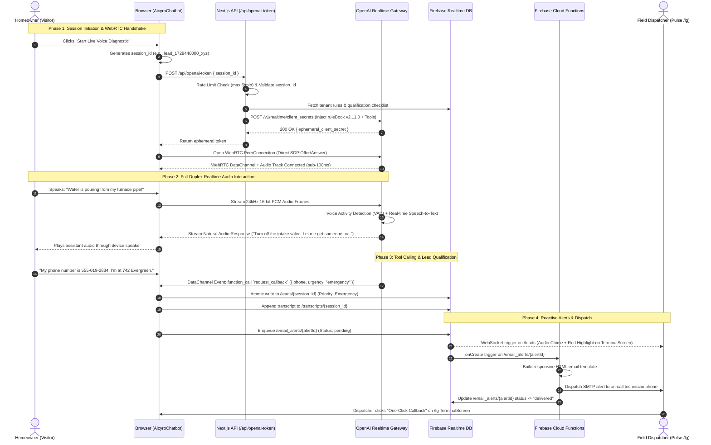

# Technical Architecture Document: CloseDesk (Aicyro)

**Architectural Role:** Senior Web Architect  
**Project:** CloseDesk (Branded as Aicyro)  
**Workspace:** `CloseDesk-Aicyro-GIT`  
**Target Runtime:** Next.js 16 (Pages Router), React 19, Tailwind CSS 3, Node.js 20+  
**Cloud & AI Backend:** Firebase Realtime Database & Storage, Firebase Cloud Functions (Node 20), OpenAI (Realtime WebRTC / GPT-4o-mini Vision / Structured JSON), AWS Polly Neural TTS  

---

## 1. Sitemap & Routing Architecture

The routing topology enforces strict separation between high-performance public marketing surfaces, authenticated administrative interfaces, and serverless backend microservices.

```text
/ (Domain Root)
│
├── [Public Marketing & Conversion Pages] (SSG / Selective Client Hydration)
│   ├── / .................................... Public Landing Page (Hero, Value Proposition, Pricing, Interactive Demos)
│   ├── /free-website-audit .................. Multi-Step Interactive Diagnostic Wizard & Dynamic PDF Generator
│   ├── /privacy ............................. Privacy Policy & Realtime Voice Recording Legal Disclosures
│   ├── /cookie .............................. Cookie Consent & Telemetry Policy
│   ├── /termofuse ........................... Terms of Service & Master Services Agreement
│   └── /404 ................................. Custom Branded Error Boundary & Fallback Navigation
│
├── [Protected Operations & Admin Routes] (Strict Client-Side SPA / Session Gate)
│   ├── /lg .................................. Pulse Admin & Superadmin Operational Workspace
│   │   ├── #home ............................ Executive KPI Cockpit, Pipeline Velocity & Conversion Metrics
│   │   ├── #terminal ........................ Inbound Lead Triage, Emergency Priority Queue & CRM Terminal
│   │   ├── #conversations ................... Full-Duplex Voice & Multimodal Chat Transcript Explorer
│   │   ├── #booking ......................... Interactive Dispatch Calendar & Appointment Manager
│   │   ├── #insight ......................... AI-Aggregated Lead Intelligence, Trend Charts & Voice Analytics
│   │   ├── #notifications ................... Real-Time Administrative Alert & Audio Ping Feed
│   │   ├── #cookie-data ..................... Visitor Geolocation Cluster Maps & Hardware Telemetry Grid
│   │   ├── #settings ........................ Tenant AI Persona, TTS Voice Tuning, SMTP Config & Credentials
│   │   └── #superadmin ...................... Multi-Tenant Client Onboarding, Billing & Global System Protocols
│   │
│   └── /logs ................................ SOC2-Compliant Distributed Observability & Audit Log Explorer
│
└── [Serverless Microservice API Layer] (Next.js Serverless Routes)
    ├── /api/chat ............................ Conversational Chat Completion Engine (OpenAI Structured JSON Mode)
    ├── /api/openai-token .................... Ephemeral WebRTC Client Secret Minter with IP Rate-Limiting
    ├── /api/analyze-image ................... Multimodal Vision Diagnostic Classifier (GPT-4o-mini Vision)
    ├── /api/leads ........................... Lead Deduplication, Ingestion & Abandonment Summarizer
    ├── /api/insights ........................ Executive Business Intelligence Aggregator
    ├── /api/generate-audit .................. Automated Enterprise SEO & Performance PDF Analysis Generator
    ├── /api/generate-email .................. Outbound CRM Webhook Dispatcher
    ├── /api/login ........................... Tenant & Superadmin Cryptographic Authentication Gate
    ├── /api/app-state ....................... Structured Log Transmission Receiver & PII Sanitizer
    ├── /api/app-query ....................... RBAC-Protected Log Query Engine with Time-Window Filters
    └── /api/cron/retention-cleanup .......... Scheduled Compliance Log Retention & Database Pruning Endpoint
```

---

## 2. System Architecture

```text
  +-------------------------------------------------------------------------------------------+
  |                                        CLIENT TIER                                        |
  |                                                                                           |
  |  +---------------------------------------+     +---------------------------------------+  |
  |  |       Public Marketing Pages          |     |        Pulse Operations Portal        |  |
  |  |  Static Pre-Rendering (SSG/ISR)       |     |  Strict Client-Side Rendering (CSR)   |  |
  |  |  Next.js Hydration + Tailwind CSS     |     |  Session Storage Auth + RBAC Guard    |  |
  |  +---------------------------------------+     +---------------------------------------+  |
  |                      |                                             |                      |
  |                      |                                             |                      |
  |  +-------------------------------------------------------------------------------------+  |
  |  |                       Aicyro Multimodal Front-Desk Widget                           |  |
  |  |  - Audio Capture (16-bit PCM / 24kHz)        - Client Photo Capture / WebP Compress |  |
  |  |  - WebRTC DataChannel (Tool Calling)         - Client State & Session Token Store   |  |
  |  +-------------------------------------------------------------------------------------+  |
  +---------------------------|---------------------------------|-----------------------------+
                              |                                 |
              HTTPS / REST (withApiLogger)         Direct Realtime WebSocket
                              |                                 |
                              v                                 v
  +-------------------------------------------------+     +-----------------------------------+
  |               APPLICATION SERVER                |     |          DATA & BUS TIER          |
  |             (Next.js API Engine)                |     |   (Firebase Realtime Database)    |
  |                                                 |     |                                   |
  |  * Input Validation & Rate Limiting (5 req/min) |     |  /leads       /prospects          |
  |  * RuleBook Injection (v2.11.0 Domain Policies) |     |  /bookings    /transcripts        |
  |  * PII Masking & Telemetry Correlation IDs      |     |  /settings    /notifications      |
  |  * Temporary WebRTC Token Minting               |     +-----------------------------------+
  +-------------------|-----------------------------+                       |
                      |                                                     |
         +------------+------------+                         Firebase onCreate Trigger
         |                         |                                        |
         v                         v                                        v
+------------------+     +--------------------+           +-----------------------------------+
|  OpenAI Gateway  |     |   Cloud Storage    |           |     ASYNC BACKGROUND WORKERS      |
|                  |     | (Firebase Storage) |           |   (Firebase Functions Node 20)    |
| * Realtime Voice |     |                    |           |                                   |
|   (WebRTC Peer)  |     | * Defect Images    |           | * sendEmailAlert (Dynamic SMTP)   |
| * Chat Completion|     | * Audit PDFs       |           | * processScheduledReminders       |
| * Vision Defect  |     +--------------------+           | * Webhook Delivery (Make.com/CRM) |
+------------------+                                      +-----------------------------------+
```

### 2.1 Rendering Strategy (SSR vs. CSR vs. SSG)
* **Static Site Generation (SSG) with Selective Client Hydration:**  
  Public marketing routes (`/`, `/privacy`, `/cookie`, `/termofuse`) are statically compiled to static HTML/CSS at build time. Dynamic client interactive components (e.g., floating chatbot widget, cookie consent dialog, modal capture forms) rehydrate on the client without blocking the First Contentful Paint (FCP target: `< 0.8s`).
* **Strict Client-Side Rendering (CSR) for Application Portals:**  
  The operations cockpit (`/lg`) and observability explorer (`/logs`) run as pure CSR Single Page Applications (SPAs). Server-side rendering is intentionally bypassed to prevent sensitive operational state or customer records from caching in edge nodes, and to maintain responsive client-side UI transitions driven by persistent WebSocket subscriptions.

### 2.2 API Communication & Real-Time Transport Strategy
* **Standard REST/JSON with Structured Tracing (`withApiLogger`):**  
  All internal API routes use Next.js serverless functions wrapped in a unified middleware pipeline. Requests are validated, assigned a unique distributed correlation UUID (`x-trace-id`), rate-limited (e.g., max 5 WebRTC token requests per minute per IP), and stripped of sensitive PII before persistence.
* **Low-Latency Sub-100ms Voice Stream (WebRTC Peer Connection):**  
  Voice sessions bypass traditional server-side audio relaying. `/api/openai-token` verifies tenant policies and mints a short-lived client secret. The client browser opens a direct WebRTC `PeerConnection` with OpenAI's Realtime gateway, streaming 24kHz bidirectional audio with sub-100ms latency.
* **Reactive Real-Time Data Bus (Firebase RTDB WebSockets):**  
  Operational updates (inbound leads, dispatcher notifications, real-time transcript streaming) rely on Firebase Realtime Database's native persistent WebSocket connection via `onValue` listeners.

### 2.3 State Management Strategy
* **Global Context & Dynamic Theme Injection:**  
  A centralized `ThemeProvider` manages CSS variables (`--primary`, `--background`, `--card-bg`). For authenticated dashboard sessions, it listens directly to Firebase RTDB `/users/{tenantId}/appearance` to dynamically theme the client without requiring a page refresh.
* **Distributed Real-Time Reactive State:**  
  Operational collections (`leads`, `bookings`, `notifications`) are bound directly to client components via Firebase RTDB synchronization. This eliminates external client state synchronization libraries (e.g., Redux) and avoids stale caching layers.
* **Ephemeral Session & Component State:**  
  Local React hooks (`useState`, `useRef`, `useReducer`) manage transient interaction states: WebRTC audio visualizer buffers, active microphone streams, multi-step audit wizard progress, and lead filter criteria.
* **Authentication & Audit State:**  
  Admin sessions persist via scoped browser storage tokens evaluated against API authorization middleware, logging SOC2-compliant audit records on privileged access changes.

---

## 3. Directory Structure

```text
CloseDesk-Aicyro-GIT/
├── .github/
│   └── workflows/
│       └── retention-cron.yml              # Daily GitHub Actions workflow triggering retention cleanup
├── docs/                                   # Architecture specs, compliance policies & QA matrices
│   ├── LOGGING_SCHEMA.md                   # Canonical JSON logging schema and PII redaction specification
│   ├── VOICE_PRIVACY_POLICY.md             # Regulatory voice disclosure and recording policy
│   ├── VOICE_PRODUCTION_READINESS_SIGNOFF.md # Production readiness criteria and voice latency budgets
│   └── VOICE_QA_TEST_SUITE.md              # Test execution suite for Realtime voice tool calling
├── evaluations/                            # Synthetic dialogue benchmarks & automated evaluation reports
│   └── report_v2.1.0.json                  # Safety, qualification, and regression test benchmark results
├── functions/                              # Serverless Cloud Functions (Node 20 runtime)
│   ├── index.js                            # Dynamic SMTP email dispatch & scheduled reminder crons
│   └── package.json                        # Backend function dependencies (firebase-admin, nodemailer)
├── public/                                 # Static public assets served from domain root
│   ├── avatars/                            # Chatbot vector avatars (ai-spark, bot-classic, minimal-dot)
│   ├── apple-touch-icon.png                # iOS PWA home screen icon
│   ├── icon.png                            # Canonical application favicon
│   └── robots.txt                          # Search crawler indexing rules (disallows /lg, /logs, /api)
├── scripts/                                # CI/CD test runners, QA simulators & parameter tuning
│   ├── industry_regression_suite.js        # Automated API test runner across 4 home-service verticals
│   ├── qa-simulator.js                     # End-to-end chat, voice, and telemetry synthetic simulator
│   ├── run_evaluations.js                  # Safety and rulebook verification harness (npm run test:ai)
│   ├── vad_tuning_harness.js               # Voice Activity Detection (VAD) cutoff latency optimization runner
│   └── voice_qa_harness.js                 # Acoustic pronunciation QA audio generator
├── src/                                    # Application source root
│   ├── assets/                             # Webpack-bundled brand assets
│   ├── components/                         # Modular UI component hierarchy
│   │   ├── Chatbot/
│   │   │   └── AicyroChatbot.jsx           # Multimodal AI front-desk (Voice WebRTC, Chat, Vision upload)
│   │   ├── Dashboard/                      # Pulse Operations & Administrative UI (/lg)
│   │   │   ├── Booking.jsx                 # Calendar management & field service appointment dispatch
│   │   │   ├── Conversations.jsx           # Conversation explorer for chat logs and voice transcripts
│   │   │   ├── CookieDataDisplay.jsx       # Visitor hardware profile and geo-location explorer
│   │   │   ├── HomeScreen.jsx              # Executive KPI dashboard, conversion rates & pipeline velocity
│   │   │   ├── Insight.jsx                 # Recharts visualizer for conversational trends and lead metrics
│   │   │   ├── LiveNotifications.jsx       # Real-time alert feed with sound notifications on urgent leads
│   │   │   ├── LoginScreen.jsx             # Tenant admin authentication gate
│   │   │   ├── Report.jsx                  # Operations reporting and CSV data export utility
│   │   │   ├── TerminalScreen.jsx          # High-density inbound lead triage and emergency response hub
│   │   │   ├── cookie/
│   │   │   │   ├── CookieGrid.jsx          # Tabular telemetry and device fingerprint data grid
│   │   │   │   └── CookieMap.jsx           # Google Maps interactive visitor cluster map
│   │   │   ├── Settings/                   # Modular tenant customization screens
│   │   │   │   ├── apearance.jsx           # Color tokens, dynamic branding, and client theme preview
│   │   │   │   ├── BusinessProfile.jsx     # Operating hours, service areas, and emergency phone routing
│   │   │   │   ├── Chatbotsetting.jsx      # AI persona prompts, qualification criteria & voice selection
│   │   │   │   ├── notification-settings.jsx # Alert routing gates and outbound SMTP credentials
│   │   │   │   └── PasswordChange.jsx      # Administrator credential rotation module
│   │   │   └── superadmin/                 # Master platform management views
│   │   │       ├── ClientManagement.jsx    # Multi-tenant onboarding, tenant provisioning & status toggles
│   │   │       ├── SuperAdminDashboard.jsx # Superadmin shell and client navigation bar
│   │   │       └── superadminlogin.jsx     # Superadmin authentication portal
│   │   ├── Essential/                      # Global layout wrappers and SEO tags
│   │   │   ├── CookieConsentBanner.jsx     # GDPR/CCPA regulatory cookie consent modal
│   │   │   ├── Footer.jsx                  # Marketing page navigation and legal links
│   │   │   ├── Navbar.jsx                  # Primary responsive navigation bar
│   │   │   └── Seo.jsx                     # Dynamic meta tags, OpenGraph cards, and JSON-LD schema
│   │   ├── Form/
│   │   │   └── Popupform.jsx               # Multi-step lead capture modal triggered on marketing CTAs
│   │   ├── Home/                           # High-conversion marketing landing page sections
│   │   │   ├── Compare.jsx                 # CloseDesk vs. legacy call center feature matrix
│   │   │   ├── Cta.jsx                     # Primary conversion banner
│   │   │   ├── Faq.jsx                     # Expandable FAQ accordion
│   │   │   ├── Hero.jsx                    # Above-the-fold value proposition and audit trigger
│   │   │   ├── NightScene.jsx              # Interactive 24/7 revenue capture visualization
│   │   │   ├── NotFor.jsx                  # Client qualification and anti-persona section
│   │   │   ├── Offer.jsx                   # Deliverables and SLA breakdown
│   │   │   ├── Pricing.jsx                 # Interactive tier calculator and ROI estimator
│   │   │   ├── Problem.jsx                 # Revenue loss calculation from missed customer calls
│   │   │   ├── TheTurn.jsx                 # Operational comparison: answering service vs. active closer
│   │   │   └── Trust.jsx                   # Social proof, uptime metrics, and security badges
│   │   ├── GlobalActivityTracker.jsx       # Global frontend error listener and telemetry transmitter
│   │   └── ThemeProvider.jsx               # Dynamic context provider binding RTDB branding to CSS vars
│   ├── lib/                                # Core libraries, telemetry tracers, and AI prompt policies
│   │   ├── activityTracker.js              # Client-side user telemetry and interaction transmitter
│   │   ├── aiTracer.js                     # AI completion tracer and safe JSON parsing utility
│   │   ├── alertManager.js                 # Throttled critical alert dispatcher writing to RTDB
│   │   ├── apiMiddleware.js                # withApiLogger HOC with correlation IDs and error boundaries
│   │   ├── auditTracer.js                  # SOC2-style administrative action audit logger
│   │   ├── cookiePersonalization.js        # Cookie consent validator and anonymous UUID generator
│   │   ├── dbTracer.js                     # Firebase Realtime Database query performance profiler
│   │   ├── firebase.js                     # Client Firebase SDK singleton initializing RTDB and Storage
│   │   ├── integrationTracer.js            # Resilient HTTP client with retry logic and PII sanitization
│   │   ├── logger.js                       # Structured logging engine with level thresholds & PII maskers
│   │   ├── loggerPresets.js                # Domain logger factories (Website, API, AI, Voice, Pulse)
│   │   ├── notificationHelper.js           # Notification creator & email_alerts queue dispatcher
│   │   ├── ruleBook.js                     # Master system prompt and conversational policies (v2.11.0)
│   │   ├── tracer.js                       # Distributed tracing library for correlation UUID propagation
│   │   └── visionRuleBook.js               # AI Vision prompt and domain rules for defect classification
│   ├── pages/                              # Next.js Pages Router entries
│   │   ├── _app.jsx                        # Global application shell, providers, and route transition logs
│   │   ├── _document.jsx                   # Base HTML document with anti-FOUC theme hydration script
│   │   ├── 404.jsx                         # Static 404 error page
│   │   ├── free-website-audit.jsx          # 16-step website audit questionnaire with instant PDF export
│   │   ├── index.jsx                       # High-performance landing page with interactive canvas
│   │   ├── layout.jsx                      # Persistent layout injecting chatbot across public routes
│   │   ├── lg.jsx                          # Pulse operations and admin dashboard portal
│   │   ├── logs.jsx                        # Dedicated system observability log explorer
│   │   ├── privacy.jsx                     # Privacy policy disclosure page
│   │   ├── cookie.jsx                      # Cookie policy disclosure page
│   │   ├── termofuse.jsx                   # Terms of service page
│   │   └── api/                            # Backend serverless endpoints (documented in Section 1)
│   └── styles/
│       └── globals.css                     # Global styles, Tailwind directives, and CSS theme variables
├── jsconfig.json                           # Import alias configuration mapping @/* to ./src/*
├── next.config.js                          # Next.js compiler settings and build configurations
├── package.json                            # Root dependencies and operational scripts
└── tailwind.config.js                      # Tailwind utility configuration and dynamic CSS variables
```

---

## 4. High-Level Data Schema

The data tier is structured across key collections in the Firebase Realtime Database:

```text
Firebase Realtime Database (Root)
│
├── /leads/{sessionId}                      # Qualified inbound customer leads
├── /prospects/{sessionId}                  # Active dialogue states & qualification checkpoints
├── /transcripts/{sessionId}                # Message logs, tool executions & voice call records
├── /bookings/{bookingId}                   # Scheduled service calls & calendar appointments
├── /analytics/visitors/{visitorId}         # Inbound traffic telemetry, hardware profiles & geolocation
├── /settings/{tenantId}                    # Custom business configuration & AI behavior parameters
├── /email_alerts/{alertId}                 # Pending notification queue consumed by Cloud Functions
└── /system_logs/{logId}                    # Structured system observability events
```

### 4.1 Inbound Leads (`/leads/{sessionId}`)
Captures qualified customer leads converted via chat, voice, or modal forms.
```json
{
  "session_id": "lead_1729440000000_a8f9b",
  "created_at": 1729440000000,
  "updated_at": 1729440060000,
  "status": "new",                          // "new" | "contacted" | "scheduled" | "archived"
  "priority": "emergency",                  // "emergency" | "high" | "normal" | "low"
  "channel": "voice",                       // "voice" | "chat" | "modal_form"
  "contact": {
    "name": "Alex Mercer",
    "phone": "+15550192834",
    "email": "alex.mercer@example.com",
    "address": "742 Evergreen Terrace",
    "city": "Springfield"
  },
  "qualification": {
    "service_required": "HVAC",
    "issue_description": "Furnace leaking water and making grinding sounds",
    "is_homeowner": true,
    "urgency_level": "immediate",
    "estimated_budget": "$1,000 - $3,000"
  },
  "media_attachments": [
    {
      "type": "image",
      "url": "https://storage.googleapis.com/.../hvac_pipe.jpg",
      "classification": "refrigerant_leak_corrosion",
      "confidence": 0.94
    }
  ],
  "assigned_dispatcher": "root",
  "crm_synced": false
}
```

### 4.2 Appointments & Calendar Bookings (`/bookings/{bookingId}`)
Tracks scheduled service calls and consultations initiated by the AI front-desk.
```json
{
  "booking_id": "book_98124_xc9",
  "session_id": "lead_1729440000000_a8f9b",
  "customer_name": "Alex Mercer",
  "phone": "+15550192834",
  "email": "alex.mercer@example.com",
  "service_type": "Emergency HVAC Inspection",
  "scheduled_timestamp": 1729512000000,     // Target ISO epoch time
  "time_slot": "10:00 AM - 12:00 PM",
  "status": "confirmed",                    // "confirmed" | "rescheduled" | "cancelled" | "completed"
  "dispatcher_notes": "Customer confirmed emergency morning slot.",
  "created_at": 1729440060000
}
```

### 4.3 Conversations & Transcripts (`/transcripts/{sessionId}`)
Stores complete dialogues, audio duration metrics, and tool invocation history.
```json
{
  "session_id": "lead_1729440000000_a8f9b",
  "mode": "voice_webrtc",                   // "voice_webrtc" | "text_chat"
  "session_duration_seconds": 184,
  "started_at": 1729440000000,
  "ended_at": 1729440184000,
  "messages": [
    {
      "id": "msg_001",
      "role": "assistant",
      "content": "Thank you for calling Precision Comfort. How can I assist you with your home today?",
      "timestamp": 1729440002000
    },
    {
      "id": "msg_002",
      "role": "user",
      "content": "My furnace is leaking water all over the basement floor.",
      "timestamp": 1729440008000
    }
  ],
  "tool_calls": [
    {
      "tool_name": "request_callback",
      "arguments": { "phone_number": "+15550192834" },
      "executed_at": 1729440045000,
      "status": "success"
    }
  ],
  "ai_summary": "Customer has active basement water leak near furnace. High urgency lead captured with callback requested."
}
```

### 4.4 Tenant Business Configuration (`/settings/{tenantId}`)
Defines runtime AI persona behavior, dynamic business details, and alert routing.
```json
{
  "business_profile": {
    "company_name": "Precision Home Services",
    "contact_email": "dispatch@precisioncomfort.com",
    "emergency_phone": "+15550100999",
    "operating_hours": "Mon-Fri: 8:00 AM - 6:00 PM; Sat: 9:00 AM - 3:00 PM",
    "service_areas": ["Springfield", "Shelbyville", "Capital City"]
  },
  "chatbot_config": {
    "bot_name": "Aicyro Specialist",
    "persona_tone": "empathetic_and_direct",
    "voice_id": "alloy",                     // "alloy" | "echo" | "shimmer" | "ash" | "coral"
    "custom_instructions": "Prioritize water leakage emergencies and advise turning off the main valve if pooling is severe.",
    "qualification_questions": [
      "Are you the homeowner or property manager?",
      "How long has the issue been occurring?"
    ],
    "voice_enabled": true
  },
  "email_config": {
    "provider": "smtp",                      // "smtp" | "microsoft_oauth" | "google_oauth"
    "smtp_host": "smtp.mailgun.org",
    "smtp_port": 587,
    "smtp_secure": false,
    "smtp_user": "postmaster@precisioncomfort.com",
    "from_name": "CloseDesk Dispatch"
  }
}
```

### 4.5 Asynchronous Email Dispatch Queue (`/email_alerts/{alertId}`)
Decoupled queue processed by Cloud Functions for outbound notification delivery.
```json
{
  "alert_id": "alert_55102_xyz",
  "created_at": 1729440065000,
  "status": "pending",                      // "pending" | "delivered" | "failed"
  "priority": "urgent",                     // "urgent" | "standard"
  "recipient": "dispatch@precisioncomfort.com",
  "subject": "🚨 CRITICAL: Emergency HVAC Lead Captured - Alex Mercer",
  "payload": {
    "customer_name": "Alex Mercer",
    "phone": "+15550192834",
    "issue": "Furnace leaking water in basement",
    "session_id": "lead_1729440000000_a8f9b"
  },
  "retry_count": 0
}
```

---

## 5. Critical User Flow: Voice Lead Capture & Real-Time Triage

Below is the step-by-step technical execution flow for the application's flagship feature: a homeowner starting a real-time voice call, having their emergency diagnosed and qualified by the AI front-desk, and immediately alerting the human dispatch team.



### Detailed Execution Steps:

1. **Session Setup & WebRTC Handshake:**
   * The client initiates the voice session by generating a cryptographically secure, rate-limit-safe session ID (`lead_{timestamp}_{hash}`).
   * The browser fires an HTTP POST to `/api/openai-token`. The API route runs through `withApiLogger`, enforces rate limits (max 5 requests/minute per IP), verifies the session identifier format against path traversal attacks, and compiles the master system prompt (`ruleBook.js` v2.11.0) along with active tenant settings.
   * `/api/openai-token` calls OpenAI's Realtime REST API to request an ephemeral client secret. The secret is returned to the client browser without exposing permanent master API keys.
   * The browser establishes a direct WebRTC `PeerConnection` with OpenAI. Audio tracks and a bidirectional JSON `DataChannel` connect with sub-100ms latency.

2. **Full-Duplex Speech & Voice Activity Detection (VAD):**
   * The client captures microphone input via the Web Audio API, formatting audio into 24kHz 16-bit PCM chunks.
   * OpenAI's server-side Voice Activity Detection automatically tracks speech start and stop boundaries, cutting off speech playback when the homeowner interrupts without causing audio clipping.

3. **Tool Execution & Structured Qualification:**
   * When the customer provides their name, location, and issue, the AI model fires structured tool calls over the WebRTC `DataChannel` (e.g., `request_callback`, `request_consultation`, `record_privacy_preference`).
   * The client widget intercepts these tool invocations, updates local conversational state, and writes the qualified lead record to Firebase Realtime Database at `/leads/{sessionId}` with priority flagged as `emergency`.

4. **Reactive Fan-Out & Dispatcher Notification:**
   * The write to `/leads` triggers real-time WebSocket updates to all active administrative instances running the `/lg` dashboard.
   * `TerminalScreen.jsx` and `LiveNotifications.jsx` receive the delta, rendering the emergency lead with an audible dispatch tone and color-coded priority badge.
   * Simultaneously, `notificationHelper.js` writes an alert task to `/email_alerts/{alertId}`. A Firebase Cloud Function (`sendEmailAlert`) picks up the record, dynamically configures the tenant's SMTP transporter, and delivers an urgent notification to on-call technicians within seconds.
